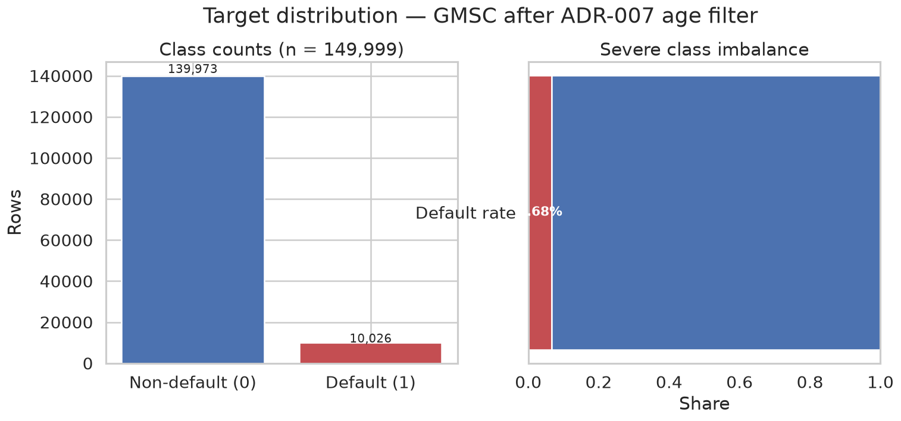
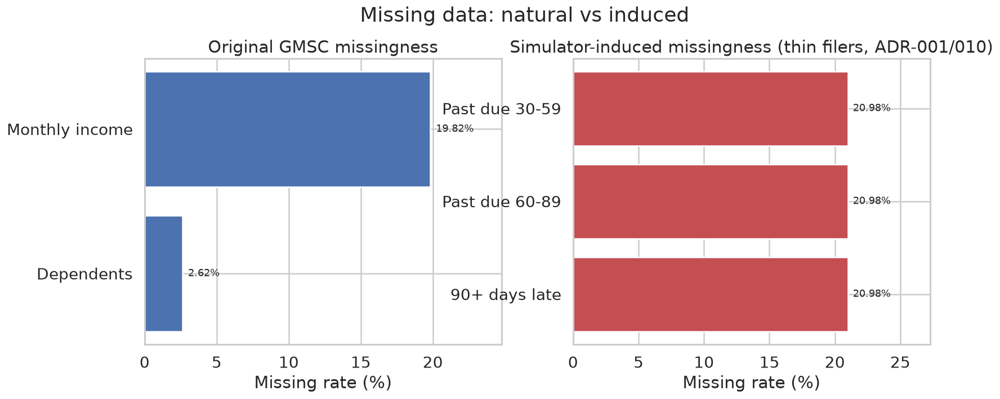
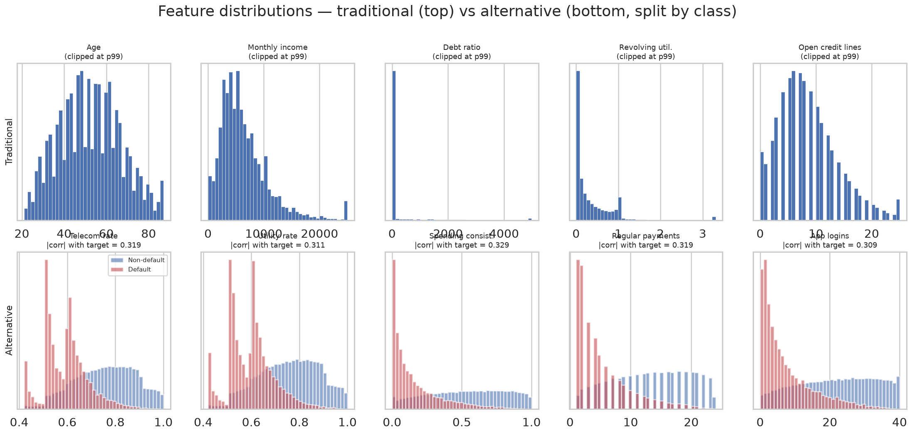
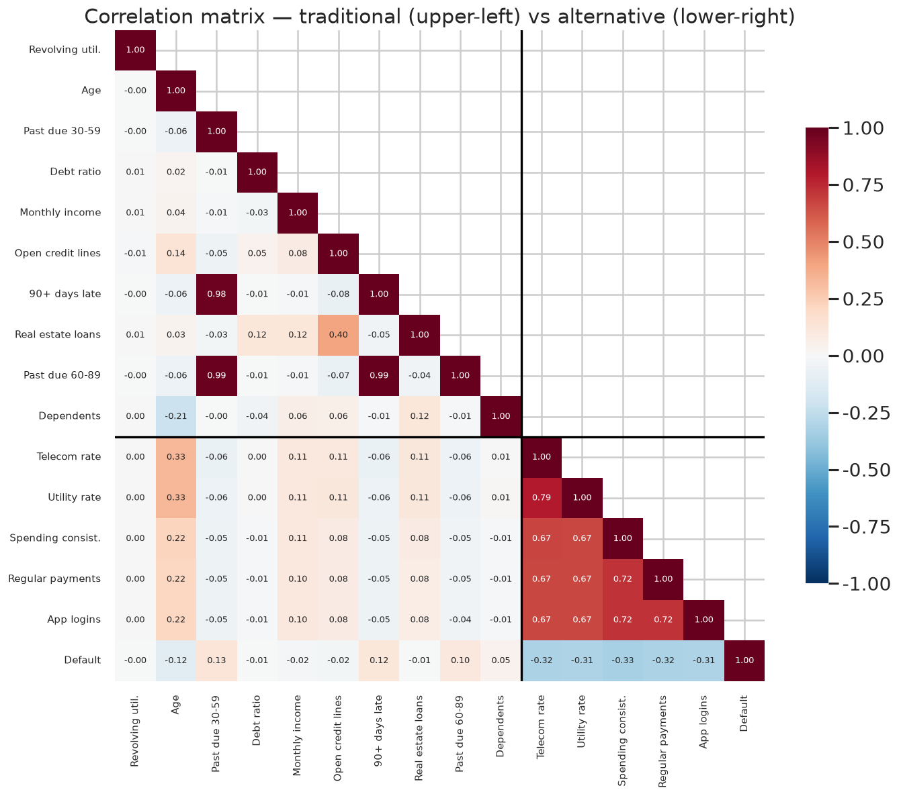
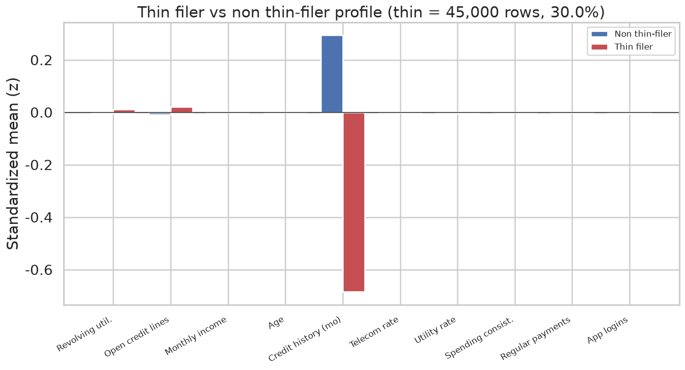
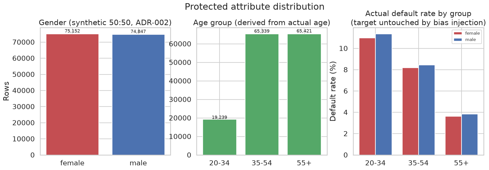

# 3. 데이터와 EDA

이 장은 모델이 보는 데이터가 **무엇이고 어떤 모양인지**를 정리한다. 원본 GMSC 에서 온 것과
시뮬레이터가 만든 것을 구분해서 본다. 둘을 섞어 읽으면 "대안 데이터가 강하다"는 관찰이
실제 데이터의 성질인지 설계의 결과인지 구분할 수 없기 때문이다.

관련 설계 결정: [ADR-006](../decisions/ADR-006-main-dataset.md)(메인 데이터셋),
[ADR-007](../decisions/ADR-007-age-filter.md)(연령 필터),
[ADR-009](../decisions/ADR-009-credit-history-months.md) · [ADR-010](../decisions/ADR-010-thin-filer-types.md)(씬파일러)

> **이 장의 공통 측정 조건.** GMSC `cs-training.csv` 에 ADR-007 필터를 적용한 **149,999행**.
> 대안 데이터·씬파일러·보호 속성은 최종 설정(`bias_ratio = 0.3`, `thin_filer_ratio = 0.30`,
> `random_state = 42`)의 시뮬레이션 결과이며, 동결된 `data/processed/` 와 같은 값이다.
> 그림은 `src/analysis/eda.py` 가 생성한다. 이 장의 z 값은 표본 표준편차 기준이다.

---

## 3.1 데이터셋

기본 데이터셋은 Kaggle **Give Me Some Credit (GMSC)** 이다. 150,000행에 타겟 1개와 피처 10개가 있다.
German Credit 은 1,000건이라 반복 CV 와 공정성 하위 집단 분석을 감당하지 못해 메인에서 제외했다(ADR-006).

| 피처 | 한글명 | 성격 |
|---|---|---|
| `RevolvingUtilizationOfUnsecuredLines` | 무담보 신용한도 소진율 | 비율 (이론상 0~1) |
| `age` | 연령 | 연속 |
| `NumberOfTime30-59DaysPastDueNotWorse` | 30-59일 연체 횟수 | 횟수 |
| `NumberOfTime60-89DaysPastDueNotWorse` | 60-89일 연체 횟수 | 횟수 |
| `NumberOfTimes90DaysLate` | 90일 이상 연체 횟수 | 횟수 |
| `DebtRatio` | 부채비율 | 비율 |
| `MonthlyIncome` | 월 소득 | 금액 |
| `NumberOfOpenCreditLinesAndLoans` | 보유 신용계좌 수 | 횟수 |
| `NumberRealEstateLoansOrLines` | 부동산 담보대출 건수 | 횟수 |
| `NumberOfDependents` | 부양가족 수 | 횟수 |
| **`SeriousDlqin2yrs`** | **2년 내 90일 이상 연체 (타겟)** | 이진 |

### 연령 필터 (ADR-007)

원본 `age` 의 최솟값은 **0** 이다(1행). 실제 연령이 아니라 입력 오류이고, 보호 속성 `age_group`
(20-34 / 35-54 / 55+) 어디에도 배정할 수 없다. 중앙값으로 채우면 가짜 연령이 공정성 분석 집단에
섞이므로 **제거**했다. 제거 후 149,999행, 최소 연령은 21세다.

---

## 3.2 타겟: 부도율 6.68%

| 클래스 | 행 | 비율 |
|---|---:|---:|
| 비부도 (0) | 139,973 | 93.32% |
| **부도 (1)** | **10,026** | **6.68%** |

부도 1건당 비부도가 약 14건이다. 이 불균형이 이후 결정 세 가지를 만들었다.

| 결정 | 이유 | 장 |
|---|---|---|
| 층화 분할 (`stratify=y`) | 무작위 분할이면 세트마다 부도율이 흔들린다 | 3.8 |
| `class_weight` / SMOTE 비교 | 가중 없이 학습하면 소수 클래스를 무시한다 | 5.5 |
| 승인 임계값 0.30 | 0.5 에서는 재현율이 거의 0 에 수렴한다 | 5.6, ADR-003 |

또 하나, 이 부도율은 **명세의 상관 요건을 해석하는 기준**이 된다. 부도율 6.68% 인 이진 타겟과의
점이연상관 0.30 은 단일 변수로 AUC 0.81 을 주는 매우 강한 조건이다(4.3절).

---

## 3.3 결측: 원래 있던 것과 만든 것

| 컬럼 | 결측률 | 출처 | 처리 |
|---|---:|---|---|
| `MonthlyIncome` | 19.82% | GMSC 원본 | train 중앙값 대체 |
| `NumberOfDependents` | 2.62% | GMSC 원본 | train 중앙값 대체 |
| 연체 3컬럼 (각각) | **20.98%** | **시뮬레이터** (씬파일러 `missing_only` + `both`) | 센티넬 −1 + 결측 플래그 |

두 종류의 결측은 **의미가 다르기 때문에 다르게 처리했다.**

원본 결측은 입력되지 않은 값이다. 중앙값으로 채워도 정보가 크게 왜곡되지 않는다.
반면 연체 3컬럼의 결측은 **"이 사람에게는 연체 기록이라는 것이 없다"는 사실 자체**이며, 씬파일러를
정의하는 신호다. 중앙값(0회)으로 채우면 기록이 없는 고객이 연체 한 번 없는 우량 고객으로
위장된다. 그래서 센티넬 −1 과 `*_is_missing` 플래그로 보존했다. 이 결정은 6.6절의 설명 생성까지
따라간다.

### 소득 결측 행의 부채비율은 비율이 아니다

| 구분 | `DebtRatio` 중앙값 | 부도율 |
|---|---:|---:|
| `MonthlyIncome` 있음 | 0.296 | 6.95% |
| `MonthlyIncome` 결측 | **1,159** | 5.61% |

소득이 결측인 행에서 부채비율 중앙값이 1,159 로 뛴다. 분모인 소득이 없어 비율 대신 부채 금액이
기록된 것으로 보인다. 3.4절의 `DebtRatio` 극단값 대부분이 여기서 온다. 트리 모델은
이 불연속을 분기로 흡수할 수 있지만, 선형 모델에는 불리한 구조다.

---

## 3.4 분포와 이상치

위 행은 전통 피처(99 백분위에서 잘라 그림), 아래 행은 대안 피처를 클래스별로 겹쳐 그렸다.

| 피처 | 중앙값 | 99 백분위 | 최댓값 | 최대 z |
|---|---:|---:|---:|---:|
| `RevolvingUtilizationOfUnsecuredLines` | 0.154 | 1.09 | **50,708** | **203.0** |
| `DebtRatio` | 0.367 | 4,979 | **329,664** | **161.6** |
| `MonthlyIncome` (결측 제외) | 5,400 | 25,000 | 3,008,750 | 208.7 |
| `age` | 52 | 87 | 109 | 3.8 |
| `NumberOfOpenCreditLinesAndLoans` | 8 | 24 | 58 | 9.6 |
| `NumberOfTimes90DaysLate` | 0 | 3 | 98 | 23.4 |

각주: 149,999행, 결측 행은 해당 피처 계산에서 제외. z = (최댓값 − 평균) / 표본 표준편차.

전통 피처는 실제 금융 데이터답게 **꼬리가 매우 두껍다.** 이상치는 제거하지 않았다. 트리 모델은 순위만
쓰므로 극단값에 강건하고, 이상치 행 자체가 위험 신호를 담고 있기 때문이다.

### 소진율: 피어슨 상관이 관계를 숨긴다

| 지표 | 값 |
|---|---:|
| 소진율 > 1 인 행 | 2.21% |
| 부도율 (소진율 > 1) | **37.25%** |
| 부도율 (소진율 ≤ 1) | 5.99% |
| 타겟과의 피어슨 상관 | **−0.002** |
| 타겟과의 스피어만 상관 | **+0.240** |

한도를 넘겨 쓴 고객의 부도율은 6배다. 그런데 피어슨 상관은 사실상 0 이다. 최댓값 50,708 같은
극단값이 선형 상관을 무너뜨리기 때문이다. 순위 상관으로는 +0.240 으로 전통 피처 중 가장 강한 편이다.
**이 피처가 SHAP 전역 중요도 3위(6.2절)인 것과 피어슨 상관 0 인 것은 모순이 아니다.**
같은 이유로 6.3절의 Dependence Plot 은 x 축을 99 백분위에서 잘라야 했다.

### 연체 코드 96 / 98

| 항목 | 값 |
|---|---:|
| 연체 3컬럼에 96 또는 98 이 기록된 행 | 269 (세 컬럼 모두 같은 행) |
| 이 행들의 부도율 | **54.65%** |
| 30-59일 vs 90일 연체 상관 (전체) | 0.984 |
| 30-59일 vs 90일 연체 상관 (269행 제외) | **0.218** |

GMSC 에는 연체 횟수로 불가능한 값 96, 98 이 269행에 있다. 실제 횟수가 아니라 특수 코드로 보인다.
이 269행이 연체 컬럼 간 상관을 0.98~0.99 로 끌어올린다. 제외하면 0.22~0.31 이다.
아래 상관행렬의 연체 3컬럼 블록은 이 코드의 영향을 받은 값으로 읽어야 한다.

**이 코드는 별도로 처리하지 않았다.** 트리 모델은 "96 이상"을 하나의 분기로 분리할 수 있고, 부도율
54.65% 라는 강한 신호를 담고 있어서다. 다만 선형 모델과 표준화에는 왜곡 요인으로 남는다.

---

## 3.5 대안 데이터 (시뮬레이션)

대안 피처 5개는 원본에 없고 시뮬레이터가 만들었다(4장). 여기서는 결과물의 모양만 본다.

| 피처 | 범위 | 평균 | 평균 (비부도) | 평균 (부도) | 타겟 \|corr\| |
|---|---|---:|---:|---:|---:|
| `telecom_payment_rate` | 0.42 ~ 1.00 | 0.747 | 0.758 | 0.592 | 0.3195 |
| `utility_payment_rate` | 0.42 ~ 1.00 | 0.747 | 0.757 | 0.596 | 0.3107 |
| `spending_consistency` | 0.00 ~ 1.00 | 0.508 | 0.533 | 0.160 | 0.3291 |
| `regular_payment_count` | 1 ~ 24 | 12.68 | 13.23 | 4.89 | 0.3194 |
| `app_login_frequency` | 0 ~ 40 | 20.29 | 21.23 | 7.17 | 0.3094 |

각주: 149,999행, 피어슨 상관 절댓값. train 만으로 잰 값은 10.2절 표 참조.

다섯 개 모두 명세 §4 의 0.3 ~ 0.5 범위에 든다. 3.4절 피처 분포 그림의 아래 행에서 부도(빨강)와
비부도(파랑)가 뚜렷이 갈리는 것이 보인다. 전통 피처의 타겟 상관(피어슨)이 최대 0.128(30-59일 연체)인 것과
대비된다. 이 차이가 5장에서 `alternative_only` 가 `traditional_only` 를 앞서는 이유이며, 실제 대안
데이터의 예측력이 아니라 **명세 요건의 결과**다.

### 상관 구조

| 블록 | 상관 | 해석 |
|---|---|---|
| 대안 ↔ 대안 | **0.667 ~ 0.794** (평균 0.698) | 공유 잠재요인 "성실성" (ADR-001 v2, 4.4절) |
| 대안 ↔ `age` | 0.33 (통신·공과금) / 0.22 (나머지 셋) | 생성식의 연령 신호 + 20-34 편향 주입 |
| 대안 ↔ `MonthlyIncome` | 0.10 ~ 0.11 (`log1p` 소득과는 0.32) | 생성식의 소득 신호. 생성식이 `log1p(소득)` 을 써서 원 단위 상관은 낮게 나온다 |
| 연체 ↔ 연체 | 0.98 ~ 0.99 | 96/98 코드 269행의 영향 (3.4절) |
| 그 밖의 전통 ↔ 전통 | 대부분 \|r\| < 0.15 | 계좌 수 ↔ 부동산 대출 0.40 이 최대 |

**대안 피처와 연령의 상관이 두 층으로 갈린다.** 통신비·공과금 납부율은 0.33, 나머지 셋은 0.22 다.
앞의 두 피처에만 **20-34 집단 하향 편향**(ADR-002)이 주입됐기 때문이다. 편향을 주입하지 않고
(`bias_ratio = 0`) 같은 시뮬레이션을 돌리면 다섯 피처 모두 0.22 로 같아진다.
7.3절에서 본 연령대 격차의 두 원천(생성식의 연령 신호, 주입 편향)이 상관행렬에 이미 드러나 있다.

---

## 3.6 씬파일러

명세 §4 의 정의는 **연체 관련 컬럼 2개 이상 결측 OR 신용카드 거래 이력 12개월 미만**이다.
GMSC 에는 거래 이력 컬럼이 없어 `credit_history_months` 를 합성했다(ADR-009).

| 판정 조건 | 행 |
|---|---:|
| 연체 컬럼 2개 이상 결측 | 31,471 |
| 거래 이력 12개월 미만 | 27,121 |
| 교집합 (둘 다) | 13,592 |
| **합집합 = 씬파일러** | **45,000 (30.0%)** |

두 조건이 서로 다른 집합을 잡아내므로 OR 정의가 실제로 작동한다. 초기 구현에서는
교집합 = 합집합 = 45,000 이라 정의가 형해화돼 있었다(4.6절, ADR-010).

| 유형 | 행 | 씬파일러 중 비율 | 연체 3컬럼 | 거래 이력 (평균) |
|---|---:|---:|---|---|
| 일반 | 104,999 | — | 관측 | 12~120개월 (66.0) |
| `missing_only` | 17,879 | 39.7% | 결측 | 12~120개월 (66.2) |
| `history_only` | 13,529 | 30.1% | 관측 | 3~11개월 (7.0) |
| `both` | 13,592 | 30.2% | 결측 | 3~11개월 (7.0) |

| 피처 (표준화 평균) | 일반 | 씬파일러 |
|---|---:|---:|
| `credit_history_months` | +0.294 | **−0.685** |
| `RevolvingUtilization` | −0.005 | +0.011 |
| `NumberOfOpenCreditLinesAndLoans` | −0.009 | +0.021 |
| 그 밖의 전통 · 대안 피처 | \|z\| ≤ 0.005 | \|z\| ≤ 0.005 |
| 부도율 | 6.66% | 6.74% |

**씬파일러와 일반 고객은 정의 기준 말고는 거의 같다.** 거래 이력만 크게 다르고, 소진율과 계좌 수의
미세한 차이는 씬파일러에게 주입한 노이즈(ADR-001)에서 온다. 부도율도 같다.

이것은 의도한 설계다. 씬파일러를 소득·연령 조건으로 뽑으면 씬파일러 여부가 보호 속성과 얽혀
7장의 공정성 분석과 교란된다(ADR-001 "버린 대안"). 무작위로 뽑았기 때문에 5.4절의 uplift 차이는
**"누가 씬파일러인가"가 아니라 "전통 정보가 얼마나 결손됐는가"** 로만 설명된다.

---

## 3.7 보호 속성

| 속성 | 집단 | 행 | 실제 부도율 |
|---|---|---:|---:|
| gender (합성) | female | 75,152 | 6.55% |
| | male | 74,847 | 6.82% |
| age_group (실제 `age` 구간화) | 20-34 | 19,239 | **11.18%** |
| | 35-54 | 65,339 | 8.32% |
| | 55+ | 65,421 | **3.73%** |

성별은 GMSC 에 없어 타겟과 독립인 무작위 50:50 으로 합성했다(ADR-002, 10.4절). 두 집단의 부도율이
사실상 같은 것은 그 때문이다.

**연령대는 실제 부도율 자체가 다르다.** 20-34 의 부도율은 55+ 의 3배다. 편향 주입은 피처만 바꾸고
타겟은 건드리지 않으므로(ADR-002) 이 차이는 GMSC 원본의 성질이다. 따라서 7장의 연령대 승인율 격차
(20-34 0.6789 vs 55+ 0.8764) 중 일부는 **실제 위험 차이를 반영한 정당한 격차**다. 승인율만 비교하는
DI Ratio 로는 이를 구분할 수 없고, 실제 라벨을 조건으로 오류율을 비교하는 **Equalized Odds 를 함께 봐야
하는 이유**가 여기에 있다(7.2절의 FPR 차이 0.1487).

---

## 3.8 전처리와 분할

| 단계 | 내용 | 근거 |
|---|---|---|
| ① 필터 | `age < 18` 1행 제거 → 149,999행 | ADR-007 |
| ② 시뮬레이션 | 대안 5변수, 씬파일러(유형·결측·노이즈), 보호 속성, 거래 이력 | ADR-001·002·009·010 |
| ③ 분할 | train / valid / test = 70 : 15 : 15, `stratify=y`, `random_state=42` | 명세 §4 |
| ④ 결측 대체 | `MonthlyIncome` → 5,400, `NumberOfDependents` → 0 (**train 중앙값**) | 3.3절 |
| ⑤ 연체 결측 | 센티넬 −1 + `*_is_missing` 플래그 3개 | 3.3절 |
| ⑥ 스케일링 | 수치형에 `StandardScaler` (**train 에만 fit**) | 명세 §4 |
| ⑦ 인코딩 | 학습 피처에 범주형이 없어 One-Hot 대상 없음. 보호 속성은 인코딩하지 않고 원문 유지 | ADR-008 |

| 세트 | 행 | 부도율 |
|---|---:|---:|
| train | 104,999 | 6.6839% |
| valid | 22,500 | 6.6844% |
| test | 22,500 | 6.6844% |

각주: `data/processed/{train,valid,test}.parquet`. 각 24열 = 학습 피처 18 + 보호 속성 2 + 세그먼트 3
(`is_thin_filer`, `thin_filer_type`, `credit_history_months`) + 타겟 1.

층화 덕분에 세 세트의 부도율 차이가 0.001%p 이내다. valid 는 ThresholdOptimizer 적합(7장)에만 쓰고,
**test 라벨은 학습·튜닝·임계값 선택 어디에도 쓰지 않았다**(명세 §7).

모델이 보는 18개 피처는 전통 10 + 결측 플래그 3 + 대안 5 다. 보호 속성과 세그먼트 컬럼 5개는 데이터에는
남지만 학습 입력에서 제외된다(ADR-008·009·010).

---

## 이 장의 결론

1. **원본 GMSC 는 불균형(부도율 6.68%)하고 꼬리가 두꺼우며 특수 코드를 품고 있다.** 소진율 최대 z=203.0,
   부채비율 161.6, 연체 코드 96/98 이 269행. 소진율은 피어슨 상관 −0.002 지만 순위 상관은 +0.240 이다.
2. **결측은 출처에 따라 다르게 다뤘다.** 원본 결측(소득 19.82%)은 중앙값 대체, 시뮬레이터가 만든 연체 결측
   (20.98%)은 "기록 없음"이라는 씬파일러 신호로 보고 센티넬 + 플래그로 보존했다.
3. **설계로 통제한 것과 원래 있는 것을 구분했다.** 씬파일러는 무작위 선정이라 정의 기준 외에는 일반 고객과
   같고(부도율 6.74% vs 6.66%), 성별은 합성이다. 반면 연령대별 부도율(20-34 11.18% vs 55+ 3.73%)은
   원본의 성질이라, 7장의 연령대 격차 일부는 실제 위험 차이다.
