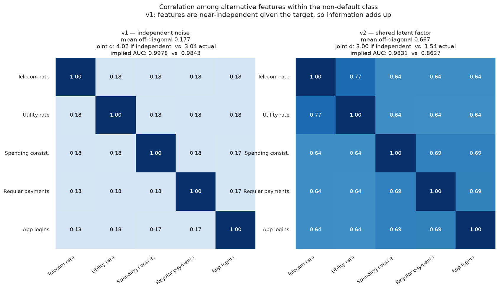
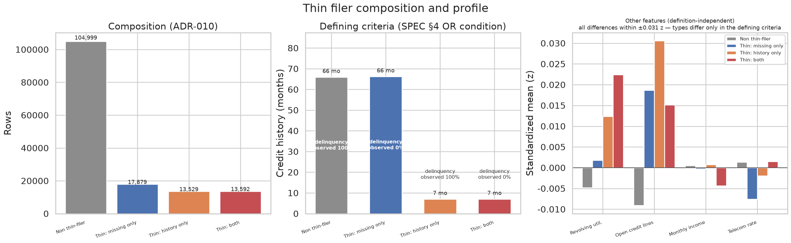

# 4. 방법론: 대안 데이터 시뮬레이터 설계와 진단

이 장은 본 프로젝트에서 가장 많은 설계 판단이 필요했던 부분을 다룬다. 대안 데이터를
시뮬레이션으로 만들어야 하는 과제에서, 처음 만든 시뮬레이터는 요구 규격을 모두 만족했지만
모델을 학습해보니 **부도를 거의 완벽하게 예측**했다. 이 장은 그 원인을 추적해 구조를 고치고,
남은 성능이 결함인지 아닌지를 판정한 과정을 기록한다.

관련 설계 결정: [ADR-001 v2](../decisions/ADR-001-simulator.md),
[ADR-009](../decisions/ADR-009-credit-history-months.md),
[ADR-010](../decisions/ADR-010-thin-filer-types.md)

---

## 4.1 설계 목표와 제약

### 요구 규격

과제 명세(SPEC §4)는 시뮬레이터에 다음을 요구했다.

| 요구사항 | 내용 |
|---|---|
| 대안 변수 5개 | `telecom_payment_rate`, `utility_payment_rate`, `spending_consistency`, `regular_payment_count`, `app_login_frequency` |
| 타겟 상관 | 각 변수와 `SeriousDlqin2yrs` 의 상관계수가 **0.3 ~ 0.5** |
| `thin_filer_ratio` | 조정하면 씬파일러 비율이 변한다 |
| `bias_ratio` | 조정하면 성별·연령대별 승인율 편향이 변한다 |

### 설계 의도: 정보량을 구조적으로 줄인다

단순히 대안 변수 5개를 붙이는 것만으로는 이 프로젝트의 질문에 답할 수 없다.
"대안 데이터가 씬파일러에게 도움이 되는가"를 검증하려면, **씬파일러의 전통 피처가 실제로
쓸모없어야** 한다. 그렇지 않으면 대안 데이터를 추가해 성능이 올라갔을 때 그것이
대안 데이터의 기여인지, 같은 정보를 두 번 넣은 결과인지 구분할 수 없다.

그래서 ADR-001 은 씬파일러에게 두 가지를 적용했다.

- **연체 3컬럼 결측 처리**: `NumberOfTime30-59DaysPastDueNotWorse`,
  `NumberOfTime60-89DaysPastDueNotWorse`, `NumberOfTimes90DaysLate`
- **강한 노이즈 주입**: `RevolvingUtilizationOfUnsecuredLines` (로그정규 배수),
  `NumberOfOpenCreditLinesAndLoans` (정수 이동)

씬파일러 선정은 **무작위**로 한다. 소득이나 연령을 조건으로 고르면 씬파일러 여부가
민감속성과 얽혀 7장의 편향 분석이 교란된다.

### 생성 구조 (v1)

각 대안 변수를 다음과 같이 만들었다. `t_z` 는 표준화한 타겟이고, `nuisance` 는
소득·연령 신호다.

```
nuisance = 0.7 · z(log1p(MonthlyIncome)) + 0.3 · z(age)
m_i      = standardize(0.6 · nuisance + 0.8 · eps_i)     eps_i 는 변수별 독립 노이즈
m_i      ← m_i 에서 t_z 성분 제거 후 재표준화              (직교화)
v_i      = rho_i · t_z + sqrt(1 - rho_i²) · m_i
```

직교화를 하면 `corr(v_i, t_z) = rho_i` 가 표본 기준으로 정확히 성립한다. 마지막으로
`v_i` 를 정규 CDF와 반올림으로 실제 단위(납부율 0.60~1.00, 결제 건수 1~24 등)로 옮기고,
변환 때문에 어긋난 상관을 고정점 반복으로 목표에 다시 맞췄다.

목표 상관 `rho_i` 는 규격 범위 0.30~0.50 에 균등 배치했다.

---

## 4.2 v1 구현과 문제 발견

### 개별 상관은 규격을 만족했다

| 변수 | \|corr\| | 규격 0.30~0.50 |
|---|---:|---|
| `telecom_payment_rate` | 0.4855 | 충족 |
| `utility_payment_rate` | 0.4398 | 충족 |
| `spending_consistency` | 0.3991 | 충족 |
| `regular_payment_count` | 0.3504 | 충족 |
| `app_login_frequency` | 0.3031 | 충족 |

### 그런데 모델이 부도를 거의 완벽하게 맞혔다

이 데이터로 18개 조합(알고리즘 3 × 피처그룹 3 × 불균형 처리 2)을 학습한 결과다.

| 피처 그룹 | test AUC (LightGBM, class_weight) |
|---|---:|
| `traditional_only` | 0.8342 |
| `alternative_only` | **0.9957** |
| `combined` | **0.9998** |

씬파일러 집단의 AUC uplift 는 **+0.234** 였다. 명세가 요구한 목표는 +0.03 이었으므로
**8배**에 해당한다. 신용평가 모델의 AUC 가 0.9998 이라는 것은 현실에서 성립할 수 없는
수치이며, 이 상태의 결과로는 어떤 분석도 신뢰할 수 없다.

---

## 4.3 원인 분석

### 규격 위반이 아니었다

먼저 확인한 것은 개별 상관이었다. 위 표에서 보듯 다섯 변수 모두 0.30~0.50 안에 있었다.
즉 **명세를 위반해서 생긴 문제가 아니다.** 문제는 개별 변수가 아니라 **결합**에 있었다.

### 원인 ①: 부도율 6.68% 에서 상관 0.3~0.5 는 매우 강한 조건이다

이진 타겟에 대한 상관계수(점이연상관)는 두 집단의 분리 정도로 환산할 수 있다.
부도율 `p = 0.0668` 일 때

```
d = r / sqrt( p(1-p)(1 - r²) )
```

| \|corr\| | Cohen's d | 그 변수 **하나만**으로 얻는 AUC |
|---:|---:|---:|
| 0.15 | 0.60 | 0.666 |
| 0.20 | 0.81 | 0.718 |
| 0.25 | 1.03 | 0.768 |
| 0.30 | 1.26 | 0.813 |
| 0.35 | 1.49 | 0.855 |
| 0.40 | 1.75 | 0.892 |
| 0.45 | 2.02 | 0.923 |
| 0.49 | 2.25 | **0.944** |

**대안 변수 하나가 전통 피처 13개를 모두 쓴 모델(0.834)을 이긴다.** 명세가 요구한
상관 범위의 상단에서는 단일 변수 AUC 가 0.94 에 달한다. 이것만으로도 규격 자체가
관대하다는 점이 드러나지만, 실제 문제는 여기서 더 나아갔다.

### 원인 ②: 타겟을 조건으로 하면 다섯 변수가 거의 독립이었다

v1 은 각 변수의 비(非)타겟 성분을 `0.6 · nuisance + 0.8 · eps_i` 로 채웠다. `nuisance` 는
공유되지만 가중치가 0.6 이고, 개별 노이즈 `eps_i` 가 0.8 로 더 크다. 그 결과 **타겟을
고정하면 다섯 변수가 서로 거의 무관**해졌다.



정상(부도=0) 집단 안에서 다섯 변수 간 상관의 평균은 v1 에서 **0.177** 이었다.
서로 다른 정보를 담은 것처럼 보이지만, 실제로는 **같은 타겟 정보를 각자 독립적인
노이즈에 실어 다섯 번 반복 전달**한 것이다.

조건부로 독립인 변수들은 정보가 제곱합으로 누적된다.

| 변수 | Cohen's d |
|---|---:|
| `telecom_payment_rate` | 2.224 |
| `utility_payment_rate` | 1.961 |
| `spending_consistency` | 1.743 |
| `regular_payment_count` | 1.498 |
| `app_login_frequency` | 1.273 |
| **결합 (조건부 독립 가정, sqrt(Σd²))** | **4.02** |

`d = 4.02` 는 Φ(4.02/√2) = **AUC 0.998** 에 해당한다. 관측된 `alternative_only`
AUC 0.9957 과 같은 크기다.

> **해석 시 주의.** `sqrt(Σd²)` 는 조건부 독립을 **가정한** 상한이다. 실제 공분산을
> 반영한 값(마할라노비스 거리)은 v1 에서 3.04(선형 판별 기준 AUC 0.984)로 조금 낮다.
> 트리 모델은 선형 판별보다 잘 맞추므로 관측 0.9957 이 그 사이에 놓인다.
> 두 수치를 같은 것으로 취급해서는 안 되지만, **자릿수와 방향은 원인 진단을 뒷받침한다.**

### 결론: 버그가 아니라 가정의 결과였다

코드에 오류는 없었다. 문제는 "다섯 개의 대안 변수가 타겟 외에는 서로 무관하다"는
**암묵적 가정**이었고, 그 가정이 현실과 맞지 않았다. 현실에서는 **통신비를 성실히 내는
사람이 공과금도 성실히 낸다.** 이 공통 요인이 없으면 다섯 변수는 독립적인 증거 다섯 개가
되어 정보가 그대로 합산된다.

---

## 4.4 v2: 공유 잠재요인 도입

### 구조 변경

비타겟 성분을 **모든 변수가 공유하는 잠재요인**과 개별 노이즈로 명시적으로 분리했다.

```
shared = standardize(0.6 · nuisance + 0.8 · common_noise)   ← 다섯 변수가 공유
m_i    = w · shared + sqrt(1 - w²) · eps_i                  ← w = latent_factor_strength
m_i    ← t_z 성분 제거 후 재표준화
v_i    = rho_i · t_z + sqrt(1 - rho_i²) · m_i
```

`shared` 는 "금융 성실성"에 해당하는 잠재 특성이다. `w` 를 키우면 다섯 변수가 서로
강하게 상관되고, 각자가 전달하는 정보가 겹치므로 결합 판별력이 낮아진다.

`w` 는 `config/config.yaml` 의 `simulator.latent_factor_strength` 로 노출했다.
목표 상관도 규격 범위의 하단(`generation_correlation` = 0.31~0.35)만 쓰도록 바꿨다.

### 효과

아래 AUC 는 모두 **LightGBM · class_weight** 조합으로 통일해 비교했다.

| 지표 | v1 | v2 |
|---|---:|---:|
| 클래스 내부 평균 상관 (정상 집단) | 0.177 | **0.667** |
| 결합 d — 조건부 독립 가정 | 4.02 | 3.00 |
| 결합 d — 실제 (공분산 반영) | 3.04 | **1.54** |
| `traditional_only` test AUC | 0.8342 | 0.8338 |
| `alternative_only` test AUC | 0.9957 | **0.8902** |
| `combined` test AUC | 0.9998 | **0.9448** |

18개 조합 전체에서의 최고값은 `combined` 0.9460(LightGBM · SMOTE)이다. 5장 참조.

위 히트맵 오른쪽이 v2 다. 클래스 내부 상관이 0.64~0.77 로 올라가면서 결합 판별력이
절반 수준으로 떨어졌다. 개별 상관은 여전히 규격 안에 있다(0.3094~0.3497).

---

## 4.5 w 레버 실험과 상보성 판정

`combined` AUC 가 0.9998 → 0.9460 으로 내려왔지만 여전히 높아 보였다. `w` 를 더 키우면
계속 내려가는지 확인했다.

> **측정 조건.** 아래 두 실험은 v2 구조를 확정하던 시점, 즉 `bias_ratio = 0.1` 에서
> 측정했다. 이후 [ADR-002 v3](../decisions/ADR-002-bias-injection.md) 으로 `bias_ratio` 를
> 0.3 으로 올렸으므로 최종 데이터의 값과 소수 셋째 자리에서 다르다
> (최종: `combined` 0.9448, `alternative_only` 0.8902, 개별 상관 0.3099~0.3285).
> 두 실험의 목적은 **레버를 움직였을 때의 반응 방향과 크기**를 보는 것이므로 결론은 같다.

### 실험 1: 공유요인 강도 `w`

생성 상관 0.31~0.35 고정, LightGBM class_weight, train 학습 → test 평가.

| `w` | 클래스 내부 평균 상관 | traditional | alternative | **combined** |
|---:|---:|---:|---:|---:|
| 0.85 | 0.692 | 0.8338 | 0.8963 | **0.9470** |
| 0.90 | 0.782 | 0.8338 | 0.8870 | 0.9420 |
| 0.92 | 0.821 | 0.8338 | 0.8843 | 0.9412 |
| 0.94 | 0.861 | 0.8338 | 0.8798 | 0.9396 |

`w` 를 0.85 에서 0.94 까지 올려도 `combined` 는 0.9470 → 0.9396, **0.007 밖에 움직이지
않았다.** 공유요인은 대안 변수들 **사이의** 중복을 늘릴 뿐, 전통 피처와 대안 피처
**사이의** 관계는 건드리지 못하기 때문이다.

### 실험 2: 생성 상관 하한

`w` = 0.85 고정.

| 생성 상관 | 실제 \|corr\| | alternative | **combined** | SPEC §4 (0.3~0.5) |
|---|---|---:|---:|---|
| **0.31~0.35 (채택)** | 0.309~0.346 | 0.8963 | **0.9470** | 충족 |
| 0.26~0.30 | 0.260~0.297 | 0.8453 | 0.9206 | **위반** |
| 0.22~0.26 | 0.220~0.259 | 0.7980 | 0.8985 | **위반** |
| 0.18~0.22 | 0.181~0.219 | 0.7549 | 0.8788 | **위반** |

`combined` 를 0.90 아래로 내리려면 개별 상관을 0.22~0.26 까지 낮춰야 하고, 그러면
명세의 상관 요건을 위반한다. **명세를 지키는 한 `combined` 의 하한은 약 0.94 다.**

### 판정: 남은 것은 누수가 아니라 상보성이다

두 실험이 가리키는 결론은 같다.

- v1 의 0.9998 은 **결합 누수**였다. 조건부 독립이라는 비현실적 가정 때문에 같은 타겟
  정보가 다섯 번 합산됐고, 공유요인을 넣자 사라졌다.
- v2 의 0.9470 은 **전통 정보와 대안 정보의 상보성**이다. `alternative_only` 0.896 과
  `traditional_only` 0.834 가 서로 다른 정보를 담고 있어 합치면 0.947 이 된다.
  이것은 결함이 아니라 **이 프로젝트가 증명하려는 현상 그 자체**다.

이 판정에 따라 목표 구간을 처음 설정한 0.85~0.90 에서 **0.90~0.95 로 정정**하고,
`latent_factor_strength = 0.85`, `generation_correlation = 0.31~0.35` 를 최종 채택했다.

> **한계로 남는 부분.** 명세의 상관 요건(0.3~0.5)을 부도율 6.68% 인 이진 타겟에 적용하면
> AUC 0.94 대가 구조적 하한이 된다. 실제 신용평가 모델의 AUC 는 통상 0.85~0.88 이므로,
> 본 리포트의 절대 수치는 실무 성능의 추정치가 아니다. 자세한 내용은 10장에서 다룬다.

---

## 4.6 씬파일러 유형 분화

### v1 의 문제: OR 정의가 형해화됐다

명세(SPEC §4)는 씬파일러를 다음으로 정의한다.

> 금융 연체 관련 컬럼 2개 이상 결측치**이거나** 신용카드 거래 이력이 12개월 미만인 고객

GMSC 에는 거래 이력 개월수 컬럼이 없어 [ADR-009](../decisions/ADR-009-credit-history-months.md)
로 `credit_history_months` 를 합성했다(씬파일러 3~11개월, 일반 12~120개월, 연령과 약한
양의 상관). 그런데 이렇게 만들자 씬파일러로 선정된 행이 **두 조건을 항상 동시에**
만족했다.

| | v1 | v2 |
|---|---:|---:|
| 연체 컬럼 2개 이상 결측 | 45,000 | 31,471 |
| 거래 이력 12개월 미만 | 45,000 | 27,121 |
| **교집합** | 45,000 | **13,592** |
| **합집합 (= `is_thin_filer`)** | 45,000 | **45,000** |

교집합과 합집합이 같으면 OR 로 쓴 정의가 아무 일도 하지 않는다. 어느 한 조건만으로도
씬파일러 전체를 잡아낼 수 있기 때문이다.

### 유형 분화 (ADR-010)

선정된 씬파일러를 세 유형으로 나눴다.

| 유형 | 비중 | 연체 3컬럼 | 거래 이력 |
|---|---:|---|---|
| `missing_only` | 40% | 결측 | 12~120개월 (정상) |
| `history_only` | 30% | 관측됨 | 3~11개월 (부족) |
| `both` | 30% | 결측 | 3~11개월 (부족) |



실제 분포는 `missing_only` 17,879건(39.7%) / `history_only` 13,529건(30.1%) /
`both` 13,592건(30.2%) 으로 설정과 일치한다. 가운데 패널이 정의 기준의 분리를 보여준다.
오른쪽 패널은 정의에 쓰이지 않는 다른 피처들의 차이가 ±0.031 z 이내라는 것,
즉 **세 유형이 정의 기준에서만 다르다**는 것을 확인해준다.

### 왜 이 분화가 중요한가

유형을 나누지 않았다면 5장에서 확인한 대비를 볼 수 없었다.

XGBoost 기준, test 22,500행을 세그먼트로 나눠 측정했다.

| 세그먼트 | n | 전통 AUC | 통합 AUC | uplift |
|---|---:|---:|---:|---:|
| 일반 | 15,696 | 0.8548 | 0.9494 | +0.0946 |
| `history_only` | 2,084 | 0.8422 | 0.9435 | +0.1013 |
| `missing_only` | 2,704 | 0.7647 | 0.9328 | +0.1681 |
| **`both`** | 2,016 | **0.7417** | 0.9299 | **+0.1883** |

`history_only` 는 연체 이력이 온전히 관측되므로 전통 모델 AUC 가 0.842 로 일반 집단과
비슷하고, 대안 데이터의 기여도 +0.101 로 작다. 반대로 `both` 는 전통 AUC 0.742 로 가장
낮고 uplift 가 +0.188 로 가장 크다.

**전통 피처의 정보량이 적을수록 대안 데이터의 기여가 커진다** — ADR-001 이 의도한 구도가
데이터로 확인되는 지점이다. 자세한 분석은 5장에서 다룬다.

### 학습 피처에서 제외한 것

`credit_history_months` 와 `is_thin_filer`, `thin_filer_type` 은 **모델 입력에서
제외**했다. `credit_history_months < 12` 는 `is_thin_filer` 의 정의 그 자체이므로,
이를 피처로 넣으면 모델이 "씬파일러 여부"를 직접 학습해 ADR-001 의 검증 구도가 무너진다.
연체 결측 여부는 `*_is_missing` 플래그로 이미 전통 피처 그룹에 반영돼 있다.

보호 속성(`gender`, `age_group`)도 같은 이유와는 다른 이유로 제외했다.
[ADR-008](../decisions/ADR-008-protected-attributes.md) 과 7장에서 다룬다.
