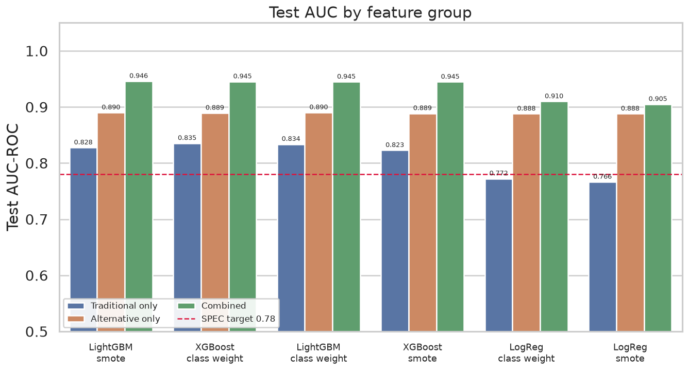
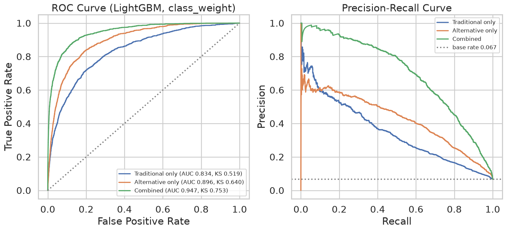
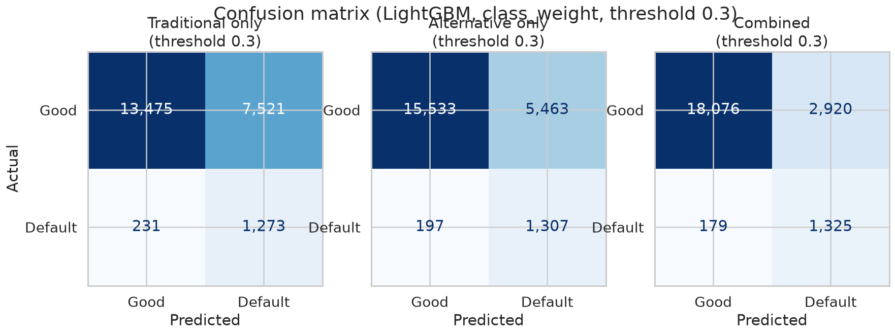
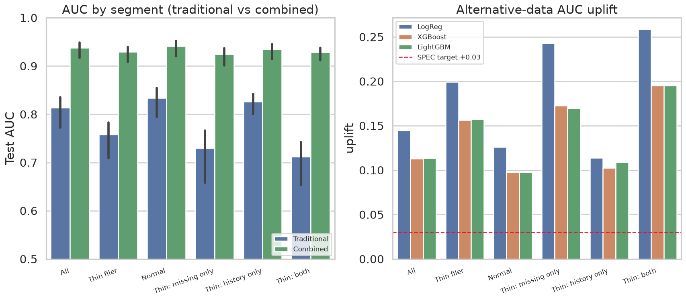

# 5. 모델 비교

이 장은 세 가지 질문에 답한다. **대안 데이터가 실제로 도움이 되는가**,
**그 도움은 누구에게 큰가**, 그리고 **어떤 알고리즘과 불균형 처리를 골라야 하는가**.

관련 설계 결정: [ADR-001 v2](../decisions/ADR-001-simulator.md) 부기(불균형 처리),
[ADR-003](../decisions/ADR-003-score-mapping.md),
[ADR-008](../decisions/ADR-008-protected-attributes.md),
[ADR-012](../decisions/ADR-012-champion-algorithm.md)

> **이 장의 공통 측정 조건.** 데이터는 `bias_ratio = 0.3` 로 생성한 최종 데이터셋.
> train 104,999행 / valid 22,500행 / test 22,500행 (70:15:15 층화 분할, `random_state=42`).
> CV 는 train 내부 `RepeatedStratifiedKFold(5×4)`, test 지표는 train 전체로 학습한 모델의
> test 세트 평가값이다. 승인 임계값은 0.30.

---

## 5.1 실험 설계

### 조합

| 축 | 수준 | 개수 |
|---|---|---:|
| 알고리즘 | Logistic Regression, XGBoost, LightGBM | 3 |
| 피처 그룹 | `traditional_only`, `alternative_only`, `combined` | 3 |
| 불균형 처리 | `class_weight='balanced'`, SMOTE | 2 |
| **조합** | | **18** |

각 조합에 `RepeatedStratifiedKFold(5×4)` = 20 fold 를 돌렸다. 총 **360 fits** 에
최종 학습 18 fits 를 더해 **소요 616.4초**다(조합별 학습 시간 합 533.5초 + CV·평가 오버헤드).

fold 별 AUC 360건은 `data/processed/fold_auc.csv` 에 저장해 8장의 ANOVA 관측치로 쓴다.

### 피처 그룹 구성

| 그룹 | 피처 | 개수 |
|---|---|---:|
| `traditional_only` | GMSC 원본 10개 + 연체 결측 플래그 3개 | 13 |
| `alternative_only` | 대안 데이터 5개 | 5 |
| `combined` | 위 둘의 합집합 | 18 |

보호 속성(`gender`, `age_group`)과 세그먼트 컬럼(`is_thin_filer`, `thin_filer_type`,
`credit_history_months`)은 **어떤 그룹에도 포함되지 않는다**(ADR-008, ADR-009).

### 불균형 처리에서 누수를 막는 방법

SMOTE 는 학습 fold 안에서만 적용해야 한다. 전체 데이터에 먼저 SMOTE 를 걸면 합성 샘플이
검증 fold 로 넘어가 성능이 부풀려진다. 이를 구조적으로 막으려고 `imblearn.pipeline.Pipeline`
으로 감쌌다. 파이프라인은 `fit` 시에만 리샘플링하고 `predict` 시에는 하지 않는다.

---

## 5.2 18개 조합 전체 결과

| 알고리즘 | 피처 그룹 | 불균형 | CV AUC ± SD | test AUC | KS | F1 | PSI |
|---|---|---|---|---:|---:|---:|---:|
| LogReg | traditional | class_weight | 0.7646 ± 0.0056 | 0.7724 | 0.3977 | 0.1518 | 0.0008 |
| LogReg | traditional | smote | 0.7560 ± 0.0057 | 0.7664 | 0.3900 | 0.1505 | 0.0006 |
| LightGBM | traditional | class_weight | 0.8354 ± 0.0045 | 0.8338 | 0.5191 | 0.2472 | 0.0014 |
| LightGBM | traditional | smote | 0.8272 ± 0.0046 | 0.8275 | 0.5033 | 0.3619 | 0.0012 |
| XGBoost | traditional | class_weight | 0.8355 ± 0.0047 | **0.8355** | 0.5234 | 0.2430 | 0.0007 |
| XGBoost | traditional | smote | 0.8219 ± 0.0051 | 0.8229 | 0.5051 | 0.3480 | 0.0014 |
| LogReg | alternative | class_weight | 0.8926 ± 0.0038 | 0.8879 | 0.6318 | 0.2766 | 0.0006 |
| LogReg | alternative | smote | 0.8926 ± 0.0038 | 0.8879 | 0.6316 | 0.2784 | 0.0005 |
| LightGBM | alternative | class_weight | 0.8918 ± 0.0038 | **0.8902** | 0.6280 | 0.3159 | 0.0013 |
| LightGBM | alternative | smote | 0.8911 ± 0.0037 | 0.8900 | 0.6207 | 0.4560 | 0.0006 |
| XGBoost | alternative | class_weight | 0.8917 ± 0.0039 | 0.8893 | 0.6285 | 0.3048 | 0.0007 |
| XGBoost | alternative | smote | 0.8919 ± 0.0036 | 0.8886 | 0.6281 | 0.4374 | 0.0005 |
| LogReg | combined | class_weight | 0.9120 ± 0.0037 | 0.9099 | 0.6720 | 0.2999 | 0.0010 |
| LogReg | combined | smote | 0.9069 ± 0.0041 | 0.9050 | 0.6620 | 0.3002 | 0.0007 |
| LightGBM | combined | class_weight | 0.9443 ± 0.0027 | 0.9448 | 0.7477 | 0.4609 | 0.0008 |
| LightGBM | combined | smote | 0.9454 ± 0.0025 | **0.9460** | 0.7497 | 0.6219 | 0.0005 |
| **XGBoost** | **combined** | **class_weight** | 0.9451 ± 0.0024 | **0.9453** | **0.7502** | 0.4378 | 0.0005 |
| XGBoost | combined | smote | 0.9447 ± 0.0025 | 0.9446 | 0.7428 | 0.6159 | 0.0006 |

각주: `bias_ratio=0.3` 최종 데이터. CV 는 train 내부 20 fold, test 는 22,500행.
원본은 `data/processed/model_results.csv`. 굵게 표시한 행이 챔피언(5.5절).

### 성능 목표 달성

| 지표 | 목표 | 결과 |
|---|---|---|
| Test AUC-ROC | ≥ 0.78 | **16/18 조합 충족**, 최고 0.9460 |
| Test KS | ≥ 0.28 | **18/18 조합 충족**, 최고 0.7502 |
| PSI (train↔test) | < 0.1 | **18/18 조합 충족**, 최대 0.0014 |
| 씬파일러 AUC 향상 | ≥ +0.03 | **충족**, +0.1518 (5.4절) |

AUC 목표를 못 넘긴 2개 조합은 모두 `LogReg × traditional_only` 다(0.7724 / 0.7664).
이는 베이스라인 조합이므로 이상하지 않다. 선형 모델에 전통 피처만 주면 GMSC 의
비선형 관계(연체 횟수의 계단 효과, 소진율의 극단값)를 잡지 못한다.

PSI 가 최대 0.0014 로 목표(0.1)보다 두 자리 작다. 층화 분할로 train/test 의 예측 점수
분포가 거의 같기 때문이다. 시계열 분할이 아니라 무작위 분할이므로 **분포 이동을 검출하는
지표로서는 관대한 조건**임을 감안해야 한다.

---

## 5.3 피처 그룹 비교: 대안 데이터의 기여



| 피처 그룹 | 최고 test AUC | 조합 |
|---|---:|---|
| `traditional_only` | 0.8355 | XGBoost / class_weight |
| `alternative_only` | 0.8902 | LightGBM / class_weight |
| **`combined`** | **0.9460** | LightGBM / SMOTE |

세 그룹의 순서가 여섯 개 (알고리즘 × 불균형) 조합 전부에서 동일하다:
`traditional < alternative < combined`. 8장의 ANOVA 는 이 차이가 통계적으로 유의함을
확인한다(F=4245.65, Tukey 3쌍 모두 p_adj < 0.0001).

`alternative_only` 가 `traditional_only` 를 앞서는 것(+0.0547)은 실제 대안 데이터의
예측력을 의미하지 않는다. 4.3절에서 설명했듯 명세가 요구한 상관 요건(0.3~0.5)이
부도율 6.68% 인 타겟에서는 매우 강한 조건이기 때문이다. **의미 있는 것은 통합 시
추가 이득**(0.8902 → 0.9460, +0.0558)이며, 이는 두 정보원이 서로 다른 것을 담고 있다는
증거다.



ROC 곡선에서 `combined` 가 낮은 FPR 구간에서 특히 유리하다. 심사에서 실제로 쓰는 구간은
FPR 0.1~0.3 대이므로 이 영역의 개선이 실질적이다.

PR 곡선은 다른 이야기를 한다. 기저 부도율이 0.067 이라 정밀도의 절대 수준이 낮다.
`combined` 도 recall 0.9 지점에서 정밀도가 0.3 을 넘지 못한다. 임계값 선택 문제는
5.6절과 10장에서 다룬다.



---

## 5.4 씬파일러 유형별 uplift — 이 장의 핵심 결과

대안 데이터가 **누구에게** 도움이 되는지를 본다. 같은 챔피언 알고리즘(XGBoost)으로
`traditional_only` 와 `combined` 를 각각 학습하고, test 세트를 세그먼트로 나눠 AUC 를 비교했다.

| 세그먼트 | n | 부도율 | 전통 AUC | 통합 AUC | **uplift** |
|---|---:|---:|---:|---:|---:|
| 전체 | 22,500 | 0.0668 | 0.8355 | 0.9453 | +0.1098 |
| 일반 (비씬파일러) | 15,696 | 0.0672 | 0.8548 | 0.9494 | +0.0946 |
| 씬파일러 전체 | 6,804 | 0.0661 | 0.7831 | 0.9349 | +0.1518 |
| └ `history_only` | 2,084 | 0.0643 | 0.8422 | 0.9435 | +0.1013 |
| └ `missing_only` | 2,704 | 0.0632 | 0.7647 | 0.9328 | +0.1681 |
| └ **`both`** | 2,016 | 0.0719 | **0.7417** | 0.9299 | **+0.1883** |

각주: XGBoost · `class_weight`, test 22,500행. `bias_ratio=0.3`.
원본은 `data/processed/thin_filer_uplift.csv`. LightGBM·LogReg 결과도 같은 파일에 있고
순서는 동일하다.



### 읽는 방법

**전통 AUC 열이 순서를 결정한다.** `history_only` 는 연체 3컬럼이 온전히 관측되므로
전통 모델이 0.8422 로 일반 집단(0.8548)과 거의 같다. 반면 `both` 는 연체 기록이 없고
거래 이력도 짧아 전통 모델이 0.7417 까지 떨어진다.

그리고 uplift 는 그 역순이다.

| 세그먼트 | 전통 AUC | uplift |
|---|---:|---:|
| 일반 | 0.8548 | +0.0946 |
| `history_only` | 0.8422 | +0.1013 |
| `missing_only` | 0.7647 | +0.1681 |
| `both` | 0.7417 | +0.1883 |

**전통 피처의 정보량이 적을수록 대안 데이터의 기여가 커진다.** 네 세그먼트에서 예외 없이
성립한다. `both` 의 uplift(+0.1883)는 일반 집단(+0.0946)의 **2배**다.

이것이 ADR-001 이 의도한 구도다. 씬파일러의 전통 피처 정보량을 구조적으로 줄여놓았기
때문에, 대안 데이터의 기여를 "누수가 아닌 결과"로 읽을 수 있다.
그리고 [ADR-010](../decisions/ADR-010-thin-filer-types.md) 의 유형 분화가 없었다면
씬파일러를 한 덩어리(+0.1518)로만 볼 수 있었고, `history_only` 와 `both` 사이의
1.9배 차이는 드러나지 않았다.

### 통합 AUC 는 세그먼트에 관계없이 비슷하다

주목할 점이 하나 더 있다. `combined` 의 AUC 는 0.9299 ~ 0.9494 로 세그먼트 간 편차가
작다(0.0195). 전통 모델의 편차는 0.1131(0.7417 ~ 0.8548)이다.

즉 **대안 데이터를 넣으면 씬파일러와 일반 고객 사이의 평가 품질 격차가 줄어든다.**
금융 포용성 관점에서 이것이 대안신용평가의 핵심 논거다. 다만 이 수치는 시뮬레이션의
산물이며 실제 크기를 나타내지 않는다(10장).

---

## 5.5 불균형 처리와 알고리즘 선정

### 불균형 처리: `class_weight` 채택

9개 (피처그룹 × 알고리즘) 쌍 전체를 비교했다.

| 피처 그룹 | 알고리즘 | class_weight | SMOTE | 차이 |
|---|---|---:|---:|---:|
| traditional | XGBoost | **0.8355** | 0.8229 | **+0.0126** |
| traditional | LightGBM | **0.8338** | 0.8275 | +0.0063 |
| traditional | LogReg | **0.7724** | 0.7664 | +0.0059 |
| alternative | XGBoost | **0.8893** | 0.8886 | +0.0007 |
| alternative | LightGBM | **0.8902** | 0.8900 | +0.0002 |
| alternative | LogReg | 0.8879 | 0.8879 | −0.0001 |
| combined | XGBoost | **0.9453** | 0.9446 | +0.0006 |
| combined | LightGBM | 0.9448 | **0.9460** | −0.0013 |
| combined | LogReg | **0.9099** | 0.9050 | +0.0049 |

각주: test AUC 기준, `bias_ratio=0.3` 최종 데이터.

`class_weight` 가 **9쌍 중 7쌍에서 우세**하고, 1쌍은 사실상 동등하다
(LogReg `alternative_only`, 반올림 전 차이 −0.00005). `traditional_only` 에서는
차이가 뚜렷하고(+0.0059 ~ +0.0126), 대안 피처가 들어가면 차이가 거의 사라진다.
SMOTE 가 실질적으로 앞선 경우는 LightGBM `combined` 한 쌍뿐이며, 그 차이 0.0013 은
**CV 표준편차(±0.0025) 미만**이다.

F1 은 이야기가 다르다.

| 조합 | class_weight F1 | SMOTE F1 | class_weight (P / R) | SMOTE (P / R) |
|---|---:|---:|---|---|
| XGBoost combined | 0.4378 | **0.6159** | 0.2899 / 0.8936 | 0.5506 / 0.6988 |
| LightGBM combined | 0.4609 | **0.6219** | 0.3121 / 0.8810 | 0.5867 / 0.6616 |

SMOTE 의 F1 이 크게 높지만 이는 **판별력이 나아진 것이 아니다.** 정밀도가 0.29 → 0.55 로
오르고 재현율이 0.89 → 0.70 으로 내려간다. SMOTE 로 학습한 모델은 예측 확률이 위로
이동하므로 고정 임계값 0.30 에서 더 보수적으로 거절한다. **재현율을 정밀도로 바꾼 것**이며,
순위 성능(AUC·KS)은 그대로다.

성능이 사실상 동등하므로 다른 기준으로 판단했다.

> **SMOTE 는 원본에 존재하지 않는 합성 샘플로 학습한다.** 이 모델의 SHAP 기여도를
> 고객에게 대출 거절 사유로 제시하면, 실재하지 않는 데이터에서 학습된 관계를 근거로
> 불이익 처분을 설명하는 셈이 된다. **신용정보법 제36조의2**(자동화평가 결과에 대한
> 설명 및 이의제기)의 설명 의무를 고려해 `class_weight='balanced'` 를 채택한다.

SMOTE 는 명세 §2 의 "불균형 처리 기법 2개 이상 비교" 요건을 위해 비교 실험으로
계속 학습·기록한다.

### 알고리즘: XGBoost 채택, 단 근거는 성능이 아니다

`combined` · `class_weight` 기준 test AUC 는 XGBoost 0.9453, LightGBM 0.9448,
LogReg 0.9099 다. 8장의 ANOVA 사후검정 결과는 다음과 같다.

| 비교 | 평균 차이 | p_adj | 유의 |
|---|---:|---:|---|
| XGBoost vs LogReg | +0.0331 | < 0.0001 | 예 |
| LightGBM vs LogReg | +0.0323 | < 0.0001 | 예 |
| **XGBoost vs LightGBM** | **+0.0008** | **0.6468** | **아니오** |

**부스팅 계열 두 개는 통계적으로 구분되지 않는다.** 따라서 "XGBoost 가 가장 성능이 좋다"는
서술은 데이터가 뒷받침하지 않는다.

XGBoost 를 고른 근거는 [ADR-012](../decisions/ADR-012-champion-algorithm.md) 에 기록했다.
**SHAP TreeExplainer 지원 성숙도와 참조 자료의 풍부함**이다. 설명가능성이 이 프로젝트의
핵심 산출물이므로 해석 도구와의 궁합을 우선했다. 성능이 동등하므로 학습·추론 비용이
병목이 되면 LightGBM 으로 교체해도 논거가 훼손되지 않는다.

### 최종 챔피언

| 항목 | 값 |
|---|---|
| 조합 | `xgboost` / `combined` / `class_weight` |
| test AUC / KS | 0.9453 / 0.7502 |
| precision / recall / F1 | 0.2899 / 0.8936 / 0.4378 |
| PSI | 0.0005 |
| 저장 위치 | `models/champion_xgboost_v1.0.pkl` |
| MLflow Registry | `credit-scoring-champion` v1, alias `champion`, tag `stage=Production` |

`config.models.champion` 에 조합을 명시했으므로, test AUC 최고 조합
(LightGBM/SMOTE 0.9460)이 아니라 이 조합이 서빙된다. 선정 근거가 성능이 아니기 때문이다.

---

## 5.6 점수 매핑과 임계값

[ADR-003](../decisions/ADR-003-score-mapping.md) 의 규칙은 다음과 같다.

```
credit_score = 1000 × (1 − p_default)
등급          A ≥ 800 / B ≥ 650 / C ≥ 500 / D ≥ 350 / 그 미만 E
승인 판정     p_default < 0.30 이면 APPROVED
```

임계값 0.30 은 **재현율을 우선한 설정**이다. 챔피언 모델의 재현율은 0.8936 으로 부도의
89% 를 잡아내지만, 정밀도는 0.2899 다. 거절한 건 가운데 실제 부도는 29% 에 그친다.

실무에서는 승인율 목표와 대손율 허용치를 함께 고려한 임계값 최적화가 필요하다.
본 프로젝트에서 0.30 을 유지한 이유는 **임계값을 바꾸면 7장의 공정성 지표(DI, EO)와
Mitigation 결과가 모두 연동되어 바뀌기 때문**이다. F1~F5 의 모든 수치를 하나의
임계값 위에서 정합시키기 위해 ADR-003 의 값으로 동결했다. 10장에서 한계로 다시 다룬다.

---

## 5.7 MLflow 실험 추적

18개 조합을 모두 MLflow 에 기록했다.

| 기록 항목 | 내용 |
|---|---|
| `params` | 알고리즘, 피처그룹, 불균형처리, 피처 수, n_splits, n_repeats, random_state, 모델 버전, 임계값 |
| `metrics` | CV AUC 평균·표준편차, valid/test AUC, KS, F1, precision, recall, PSI |
| `metrics` (step) | `fold_auc` 20 step — fold 별 AUC 를 시계열로 기록 |
| `artifacts` | 모델 (cloudpickle 직렬화) |
| `tags` | feature_group, algorithm, imbalance_method |

Model Registry 에는 챔피언을 등록하고 alias `champion` 과 tag `stage=Production` 을
붙였다. 이전 버전은 삭제하지 않고 `stage=Archived` 로 내린다.

백엔드는 SQLite(`sqlite:///mlflow.db`)를 쓴다. MLflow 3.x 가 파일 저장소를 유지보수
모드로 차단했고, Model Registry 는 애초에 파일 저장소에서 지원되지 않는다.
`docker compose up` 후 `localhost:5000` 에서 확인할 수 있다.

---

## 이 장의 결론

1. **대안 데이터는 명확히 기여한다.** 피처 그룹 순서가 여섯 개 조합 전부에서
   `traditional (0.8355) < alternative (0.8902) < combined (0.9460)` 으로 동일하고,
   성능 목표 4개를 모두 충족한다(AUC 16/18, KS 18/18, PSI 18/18, uplift +0.1518).
2. **기여의 크기는 전통 피처의 결손에 비례한다.** 씬파일러 유형별 uplift 가
   `history_only` +0.1013 < `missing_only` +0.1681 < `both` +0.1883 로,
   전통 AUC 가 낮은 순서와 정확히 역순이다. 통합 모델은 세그먼트 간 AUC 편차를
   0.1131 → 0.0195 로 줄인다.
3. **선정 근거는 성능만으로 결정되지 않았다.** 불균형 처리는 성능이 동등해
   설명가능성(합성 샘플 문제, 신용정보법 §36-2)으로 `class_weight` 를 골랐고,
   알고리즘은 XGBoost 와 LightGBM 이 통계적으로 구분되지 않아(p_adj=0.6468)
   SHAP 지원 성숙도로 XGBoost 를 골랐다.
