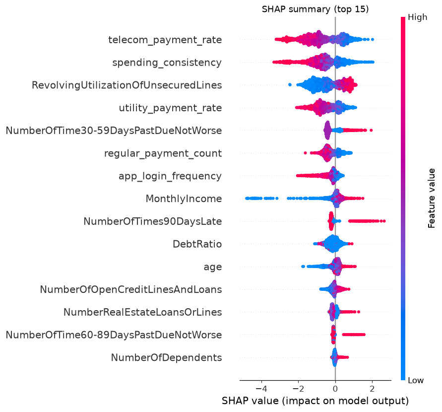
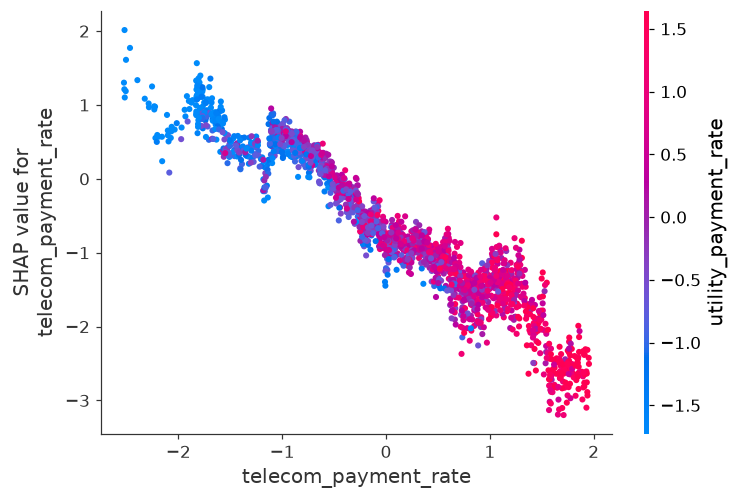
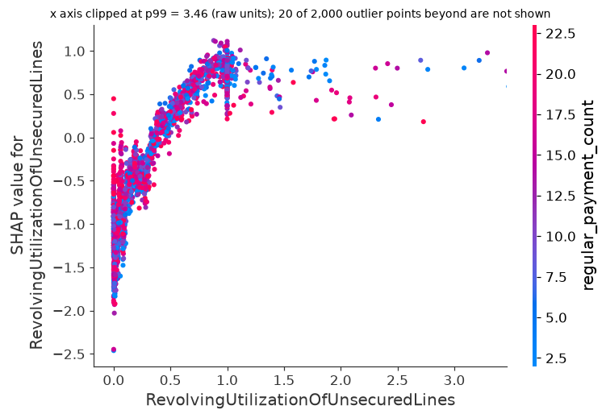
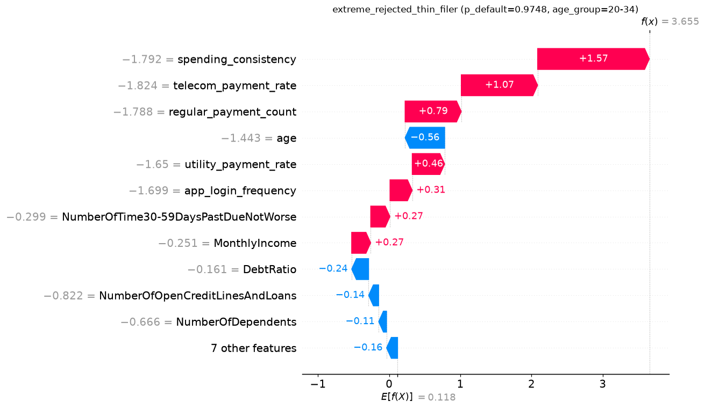
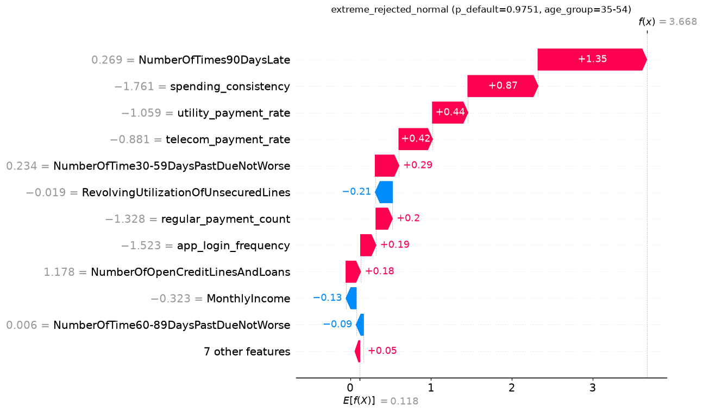
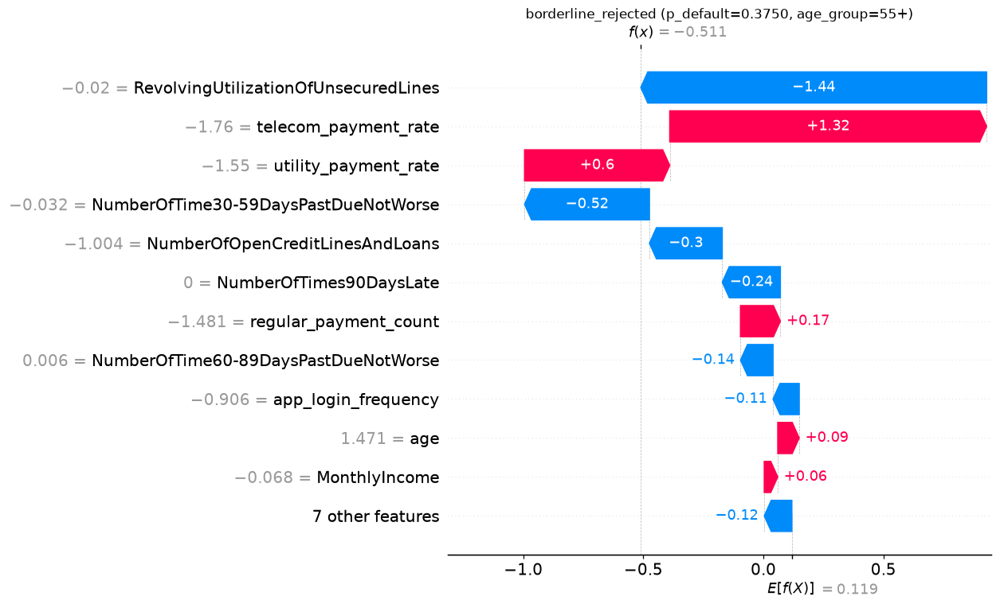
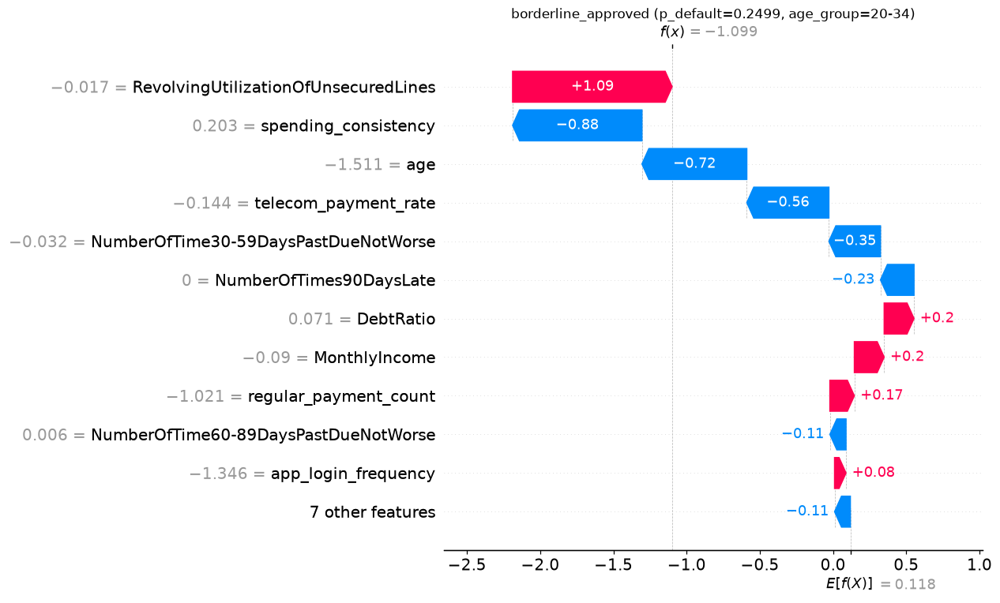

# 6. XAI 분석

이 장은 세 가지 질문에 답한다. **모델은 무엇을 근거로 판단하는가**(전역),
**특정 고객은 왜 거절됐는가**(지역), 그리고 **그 설명을 고객에게 그대로 내보내도 되는가**(생성 로직).
마지막 질문이 가장 까다롭다. SHAP 값은 수학적으로 정확하지만, 그것을 문장으로 옮기는 순간
틀린 말이 섞일 수 있기 때문이다.

관련 설계 결정: [ADR-001 v2](../decisions/ADR-001-simulator.md)(대안 피처 생성 구조),
[ADR-008](../decisions/ADR-008-protected-attributes.md),
[ADR-012](../decisions/ADR-012-champion-algorithm.md)(SHAP 지원 성숙도)

> **이 장의 공통 측정 조건.** 챔피언 모델 `xgboost | combined | class_weight`, `bias_ratio = 0.3`
> 최종 데이터, SHAP `TreeExplainer`. 전역 해석은 test 세트에서 `random_state=42` 로 뽑은
> **2,000행 표본**, 지역 해석은 test 22,500행에서 조건에 맞는 사례를 골랐다. 승인 임계값 0.30.
> 원본은 `data/processed/explain/` (`global_importance.csv`, `rejection_reasons_sample.json`).

---

## 6.1 무엇을 설명하는가: 단위와 부호

### SHAP 값의 단위는 로그 오즈다

XGBoost 이진 분류기의 원시 출력은 부도의 **로그 오즈**다. SHAP 은 이 값을 피처별 기여로 분해한다.

```
f(x) = E[f(X)] + Σ φ_i            (φ_i = 피처 i 의 SHAP 값)
p_default = 1 / (1 + exp(−f(x)))
```

기준값 `E[f(X)]` 는 **0.1183** 이고, 확률로 바꾸면 0.5295 다. 실제 부도율(6.68%)이 아니라
0.5 근처에 놓이는 이유는 `class_weight='balanced'` 로 학습해 양성과 음성의 가중을 맞췄기
때문이다. 따라서 이 모델의 예측 확률은 **가중된 척도**이며, 승인 임계값 0.30 도 이 척도 위의
값이다. 로그 오즈로는 **−0.8473** 이다. 워터폴에서 `f(x)` 가 이 값보다 작으면 승인이다.

### 부호 규약: 두 관점을 모두 싣는다

| 필드 | 관점 | 양수 | 음수 | 출처 |
|---|---|---|---|---|
| `shap_value_default` | 부도 확률 | **불리** (부도 확률 ↑) | 유리 | SHAP 원본 |
| `shap_contribution` | 신용도 | 유리 | **불리** | 명세 §3 예시 `(기여도: -0.15)` |

모델은 부도를 예측하므로 SHAP 원본은 "양수 = 고객에게 불리"다. 그런데 명세의 거절 사유 예시는
불리한 요인을 `-0.15` 로 적는다. 고객이 읽는 문장에서는 **음수가 불리**해야 직관에 맞으므로
`shap_contribution = −φ` 로 부호를 뒤집어 담고, 혼동을 막기 위해 원본 값도 `shap_value_default`
로 함께 반환한다. 워터폴 그림은 SHAP 원본(빨강 = 부도 확률 ↑)을 그대로 쓴다.

---

## 6.2 전역 해석: 대안 피처가 판단의 중심에 있다



| 순위 | 피처 | 한글명 | 유형 | 평균 \|SHAP\| |
|---:|---|---|---|---:|
| **1** | `telecom_payment_rate` | 통신비 정상납부율 | **대안** | **1.0272** |
| **2** | `spending_consistency` | 소비 일관성 점수 | **대안** | 0.8200 |
| 3 | `RevolvingUtilizationOfUnsecuredLines` | 무담보 신용한도 소진율 | 전통 | 0.7654 |
| **4** | `utility_payment_rate` | 공과금 납부율 | **대안** | 0.6314 |
| 5 | `NumberOfTime30-59DaysPastDueNotWorse` | 30-59일 연체 횟수 | 전통 | 0.4052 |
| **6** | `regular_payment_count` | 정기결제 건수 | **대안** | 0.3806 |
| **7** | `app_login_frequency` | 앱 접속 빈도 | **대안** | 0.3279 |
| 8 | `MonthlyIncome` | 월 소득 | 전통 | 0.2884 |
| 9 | `NumberOfTimes90DaysLate` | 최근 90일 연체 횟수 | 전통 | 0.2519 |
| 10 | `DebtRatio` | 부채비율 | 전통 | 0.2325 |
| 11 | `age` | 연령 | 전통 | 0.2038 |
| 12 | `NumberOfOpenCreditLinesAndLoans` | 보유 신용계좌 수 | 전통 | 0.1617 |
| 13 | `NumberRealEstateLoansOrLines` | 부동산 담보대출 건수 | 전통 | 0.1254 |
| 14 | `NumberOfTime60-89DaysPastDueNotWorse` | 60-89일 연체 횟수 | 전통 | 0.1248 |
| 15 | `NumberOfDependents` | 부양가족 수 | 전통 | 0.0539 |
| 16~18 | 연체 결측 플래그 3종 | 기록 없음 표지 | 전통 | 0.0000 |

각주: test 2,000행 표본의 평균 \|SHAP\|(로그 오즈). 원본 `global_importance.csv`.

### 읽는 방법

**대안 피처 5개가 전부 7위 안에 있다**(1·2·4·6·7위). 1위 `telecom_payment_rate`(1.0272)는
2위 `spending_consistency` 의 1.25배, 전통 피처 중 가장 높은 `RevolvingUtilization`(3위)의
1.34배다. 상위 15개 구성은 전통 10 · 대안 5 로, 피처 수로는 전통이 많지만 기여 크기는 대안에 쏠려 있다.

| 집계 | 대안 (5개) | 전통 (13개) | 배율 |
|---|---:|---:|---:|
| 피처당 평균 \|SHAP\| | **0.6374** | 0.2010 | **3.2배** |
| 피처당 평균 \|SHAP\| (결측 플래그 3개 제외) | 0.6374 | 0.2613 (10개) | 2.4배 |
| 전체 \|SHAP\| 합에서 차지하는 비중 | **54.9%** | 45.1% | — |

피처 18개 중 5개(28%)가 기여의 54.9% 를 차지한다. 다만 이 비중은 4.3절에서 설명한 시뮬레이터의
구조적 성질(명세의 상관 요건이 부도율 6.68% 에서 매우 강하다)을 반영하므로, "실제 대안 데이터가
전통 데이터보다 중요하다"는 근거로 읽으면 안 된다. **의미가 있는 것은 아래의 집단 간 비교다.**

### 개별 고객 수준: 씬파일러일수록 대안 피처에 기댄다

평균 \|SHAP\| 은 표본 전체를 뭉뚱그린 값이다. 고객 한 명 한 명의 설명에서 대안 피처가
얼마나 등장하는지를 따로 셌다.

| 세그먼트 | n | Top 5 중 대안 피처 수 (평균) | 1위가 대안 피처인 비율 |
|---|---:|---:|---:|
| 전체 | 2,000 | 3.02 | 65.2% |
| 일반 | 1,425 | 2.95 | 64.1% |
| 씬파일러 | 575 | **3.20** | **67.8%** |
| └ `history_only` | 174 | 3.00 | — |
| └ `missing_only` | 228 | 3.26 | — |
| └ `both` | 173 | **3.34** | — |

각주: 행마다 \|SHAP\| 상위 5개 피처를 뽑아 대안 피처 개수를 셌다. test 2,000행 표본.

씬파일러 유형별 순서 `history_only < missing_only < both` 는 5.4절의 uplift 순서
(+0.1013 < +0.1681 < +0.1883)와 **같다.** 전통 피처의 정보가 적은 고객일수록 모델이 대안 피처를
더 많이 쓰고, 그만큼 대안 데이터를 넣었을 때의 성능 이득도 크다. 성능(5장)과 설명(6장)이
같은 구조를 가리킨다.

### 결측 플래그 3종의 기여가 정확히 0 인 이유

연체 결측 플래그는 학습 피처에 포함돼 있지만 SHAP 이 0.0000 이다. 트리가 이 플래그로 한 번도
분기하지 않았다는 뜻이다. 연체 컬럼 자체가 결측일 때 센티넬 `−1` 을 갖기 때문에(6.6절),
`연체 횟수 < 0` 이라는 분기 하나로 같은 정보를 얻을 수 있었던 것으로 보인다.
정보가 사라진 것이 아니라 **연체 컬럼의 SHAP 값에 합쳐져 있다.**

---

## 6.3 Dependence Plot: 대안 1 + 전통 1

명세는 최소 2개 변수의 Dependence Plot 을 요구한다. 형태가 다른 두 피처를 대비하려고
대안 1위(`telecom_payment_rate`)와 전통 1위(`RevolvingUtilization`)를 골랐다
(`config.explainer.dependence_features`).

### `telecom_payment_rate`: 거의 직선



| 지표 | 값 |
|---|---:|
| 피처값–SHAP 순위상관 (Spearman) | **−0.957** |
| 선형 기울기 (표준화 1SD 당) | −0.941 로그 오즈 |
| 선형 기울기 (원 단위 1%p 당) | −0.073 로그 오즈 |
| SHAP 범위 | −3.20 ~ +2.01 |

각주: test 2,000행 표본. x 축은 표준화 값(원 단위 표준편차 0.1294).

납부율이 오를수록 부도 확률 기여가 **단조롭고 거의 선형으로** 내려간다. 색(상호작용 피처로 자동
선택된 `utility_payment_rate`)이 세로로 갈리지 않고 **x 축을 따라** 파랑에서 빨강으로 바뀐다.
두 피처가 강하게 함께 움직인다는 뜻이며, ADR-001 v2 의 공유 잠재요인("성실한 사람은 통신비도
공과금도 잘 낸다")이 그림에 그대로 드러난 것이다. 뚜렷한 상호작용은 보이지 않는다.

### `RevolvingUtilization`: 이상치 때문에 x 축을 잘라야 한다



그림 각주: x 축은 **원 단위**이며 **99 백분위(3.46)에서 잘랐다.** 표본 2,000개 중 이를 넘는
**이상치 20개는 그림에서 제외**했다(SHAP 계산에는 포함). 제외된 점의 SHAP 은 0.01 ~ 1.06 으로
그림 오른쪽 평탄 구간과 같은 범위다.

처음에는 이 피처도 telecom 과 같은 방식(표준화 값, 전 범위)으로 그렸는데, 점 거의 전부가 x = 0 근처
세로 한 줄에 몰려 관계가 보이지 않았다.

| 지표 (표준화 축으로 그렸을 때) | 값 |
|---|---:|
| 표준화 값 1~99 백분위 | −0.020 ~ −0.011 |
| \|z\| > 1 인 점 | 2,000개 중 **2개** (최대 z = 74.6) |
| 원 단위 중앙값 / 99 백분위 / 최대 | 0.144 / 3.46 / **29,110** |

GMSC 원본의 극단 이상치(149,999행 기준 소진율 최대 50,708, z = 203.0, 3.4절)가 표준화 축을 늘려,
표본의 98% 가 폭 0.009 의 구간에 갇힌 것이다. 원 단위로 바꾸고 99 백분위에서 자르자 관계가 드러났다.

| 소진율 구간 | n | 평균 SHAP |
|---|---:|---:|
| 0 ~ 0.1 | 892 | −1.096 |
| 0.1 ~ 0.5 | 551 | −0.314 |
| 0.5 ~ 1.0 | 443 | +0.608 |
| 1.0 ~ 3.46 | 94 | +0.687 |
| 3.46 초과 (그림에서 제외) | 20 | 0.01 ~ 1.06 (범위) |

각주: test 2,000행 표본, 구간 상한 포함. 피처값–SHAP 순위상관(Spearman) +0.897, SHAP 범위 −2.46 ~ +1.12.

**한도의 100% 까지는 가파르게 오르다가 그 뒤로는 평탄하다.** 소진율 10% 이하인 고객은 부도 확률 기여가
크게 음수(−1.10)이고, 한도를 거의 다 쓰면 양수로 돌아선다. 한도를 넘겨 쓴 뒤로는 더 오르지 않는다.
telecom 의 직선과 뚜렷이 다른 **포화형 비선형 관계**다. 색(`regular_payment_count`)은 세로로 갈리지 않아
뚜렷한 상호작용은 보이지 않는다.

두 그림의 대비는 이렇게 정리된다. 대안 피처는 시뮬레이터가 정규분포 기반으로 생성해 **매끄러운 선형
관계**를 갖고, 전통 피처는 실제 금융 데이터의 **두꺼운 꼬리와 포화**를 그대로 안고 있다.

### 역설적인 부호: 소득이 높으면 불리하다?

Summary Plot 을 다시 보면 설명하기 어려운 점이 두 개 있다. `MonthlyIncome` 과 `age` 는
**값이 클수록(빨강) SHAP 이 양수, 즉 부도 확률을 올린다.** 원 데이터에서는 반대다.

| 피처 | 원 데이터: 피처–부도 상관 | 전통 전용 모델: 피처–SHAP | **통합 모델: 피처–SHAP** |
|---|---:|---:|---:|
| `MonthlyIncome` | −0.062 | −0.516 | **+0.769** |
| `age` | −0.113 | −0.865 | **+0.448** |
| `NumberOfOpenCreditLinesAndLoans` | −0.033 | +0.710 | +0.831 |

각주: 모두 Spearman 순위상관. 원 데이터 열은 train 104,999행, 모델 열은 test 2,000행 표본.
전통 전용 모델은 챔피언과 같은 하이퍼파라미터로 `traditional_only` 13개 피처에 재학습했다
(같은 절차로 통합 모델을 재학습하면 챔피언의 +0.769 / +0.448 이 그대로 재현된다).

**대안 피처가 들어가면서 부호가 뒤집혔다.** 원인은 4장의 생성식에 있다.

```
대안 피처 = ρ·(타겟 신호) + … + (소득·연령 신호: nuisance = 0.7·소득 + 0.3·연령)
```

대안 피처 값에는 타겟 신호와 소득·연령 신호가 섞여 있다. 같은 통신비 납부율 85% 라도
소득이 높은 사람이라면 그 85% 중 상당 부분이 "소득 덕분"으로 설명되고, **남는 성실성 신호는
작다.** 모델은 이를 학습해 대안 피처의 좋은 값에서 소득·연령 몫을 빼는 방향으로 소득·연령에
양의 기여를 준다. 통계에서 말하는 **설명 소거(explaining away)** 효과다.
`NumberOfOpenCreditLines` 는 두 모델에서 부호가 같으므로 이 효과와 무관하다.

이 현상은 시뮬레이터의 산물이지만 실무에 주는 경고는 실재한다. **SHAP 은 모델이 학습한 관계를
충실히 보여줄 뿐, 그 관계가 인과적으로 타당한지는 말해주지 않는다.** 이를 고객에게
"월 소득이 많아서 불리합니다"라고 전달하면 설명은 정확하되 납득할 수 없는 문장이 된다.
6.5절의 방향 일치 검증이 이 경우를 잡아낸다.

---

## 6.4 지역 해석: 네 사례의 Waterfall

`config.explainer.samples` 에 네 가지 조건을 두고, 조건 구간의 중앙에 가장 가까운 test 고객을 골랐다.

| 사례 | 세그먼트 | 연령대 | 실제 부도 | p_default | f(x) | 점수 / 등급 | 결정 |
|---|---|---|---:|---:|---:|---|---|
| 극단 거절 · 씬파일러 | `both` | 20-34 | 1 | 0.9748 | +3.655 | 25 / E | 거절 |
| 극단 거절 · 일반 | 일반 | 35-54 | 1 | 0.9751 | +3.668 | 25 / E | 거절 |
| **경계 거절** | **`both`** | 55+ | **0** | **0.3750** | **−0.511** | 625 / C | **거절** |
| 경계 승인 | 일반 | 20-34 | 0 | 0.2499 | −1.099 | 750 / B | 승인 |

각주: 조건 구간 — 극단 p ∈ [0.95, 1.01), 경계 거절 [0.30, 0.45), 경계 승인 [0.20, 0.30).
임계값의 로그 오즈는 −0.847. 점수·등급은 ADR-003.

### 극단 사례: 설명은 맞지만 쓸모가 없다



| 순위 | 씬파일러 (p=0.9748) 거절 사유 | 기여도 |
|---:|---|---:|
| 1 | 소비 일관성 점수가 0%로, 동일 연령대 평균(39%) 대비 낮습니다 | −1.57 |
| 2 | 통신비 정상납부율이 51%로, 동일 연령대 평균(62%) 대비 낮습니다 | −1.07 |
| 3 | 정기결제 건수가 1건으로, 동일 연령대 평균(10건) 대비 적습니다 | −0.79 |
| 4 | 공과금 납부율이 53%로, 동일 연령대 평균(62%) 대비 낮습니다 | −0.46 |
| 5 | 앱 접속 빈도가 1회로, 동일 연령대 평균(16회) 대비 적습니다 | −0.31 |



| 순위 | 일반 (p=0.9751) 거절 사유 | 기여도 |
|---:|---|---:|
| 1 | 최근 90일 연체 횟수가 1회로, 동일 연령대 평균(0회) 대비 많습니다 | −1.35 |
| 2 | 소비 일관성 점수가 1%로, 동일 연령대 평균(49%) 대비 낮습니다 | −0.87 |
| 3 | 공과금 납부율이 61%로, 동일 연령대 평균(75%) 대비 낮습니다 | −0.44 |
| 4 | 통신비 정상납부율이 63%로, 동일 연령대 평균(75%) 대비 낮습니다 | −0.42 |
| 5 | 30-59일 연체 횟수가 1회로, 동일 연령대 평균(0회) 대비 많습니다 | −0.29 |

각주: `rejection_reasons_sample.json`. 기여도는 `shap_contribution`(음수 = 불리).

두 사례의 차이는 분명하다. **씬파일러의 거절 사유는 5개 전부 대안 피처**다. 전통 피처에
판단 근거가 없으니 모델이 대안 피처만으로 판단했다. 일반 고객은 1위가 90일 연체, 5위가 30-59일
연체로 전통과 대안이 섞인다. 6.2절의 집단 비교를 사례 하나가 그대로 보여준다.

그러나 이 설명들은 **XAI 로서의 가치가 거의 없다.** 두 고객은 로그 오즈 +3.66 으로 임계값(−0.85)과
4.5 이상 떨어져 있다. 소비 일관성 0%, 90일 연체 이력이 있는 고객이 거절된 이유는 설명하지 않아도
자명하고, 현실적인 한두 가지 변화로 결정이 바뀌지도 않는다. 설명가능성이 필요한 곳은 판단이
갈리는 경계다. 초기 구현은 극단 사례(당시 데이터에서 p=0.9997)만 저장했는데, 이 이유로
경계 구간 사례를 추가했다.

### 경계 거절: 설명이 행동으로 이어지는 사례



이 고객은 **거래 이력 11개월, 연체 기록이 없는 `both` 유형 씬파일러**(66세)이고,
**실제로는 부도가 나지 않았다.** 모델은 부도 확률 0.3750 으로 임계값 0.30 을 넘겨 거절했다.
정상 고객을 잘못 거절한 사례다.

로그 오즈로 보면 `f(x) = −0.511`, 임계값 −0.847 과의 차이는 **0.337** 에 불과하다.
워터폴에서 가장 큰 막대는 오히려 유리한 쪽이다. 신용한도 소진율이 0.94% 로 매우 낮아
−1.38 만큼 부도 확률을 끌어내렸다. 그 이득을 여러 개의 작은 불리 요인이 조금씩 되돌렸다.

| 순위 | 거절 사유 (`POST /explain` 응답) | 기여도 | 방향 일치 |
|---:|---|---:|---|
| 1 | 월 소득이 13,300으로, 동일 연령대 평균(6,579) 대비 많습니다 — 다른 항목과의 조합에 따른 영향입니다 | −0.40 | ✗ |
| 2 | 보유 신용계좌 수가 20개로, 동일 연령대 평균(9개) 대비 많습니다 — 다른 항목과의 조합에 따른 영향입니다 | −0.31 | ✗ |
| 3 | 앱 접속 빈도가 6회로, 동일 연령대 평균(23회) 대비 적습니다 | −0.21 | ✓ |
| 4 | 30-59일 연체 횟수 기록이 없습니다. 동일 연령대 평균은 0회입니다 | −0.21 | ✓ |
| 5 | 소비 일관성 점수가 25%로, 동일 연령대 평균(56%) 대비 낮습니다 | −0.17 | ✓ |

각주: 대시보드 기본 입력(`config.dashboard.default_input`, test idx 20837 과 동일 고객)으로
`POST /explain` 을 호출한 응답. 배치 산출물 `rejection_reasons_sample.json` 과 문장까지 일치한다.

1·2위는 6.3절의 설명 소거 효과와 씬파일러 노이즈 컬럼(ADR-001)에서 온 기여라 문장만으로는
납득하기 어렵다. 시스템은 이를 숨기지 않고 **방향 불일치 표지**를 붙였다.

#### 무엇을 바꾸면 승인되는가

거절 사유 Top 5 는 "현재 값이 결정을 어느 쪽으로 얼마나 밀었는가"에 답한다.
고객이 실제로 궁금한 것은 "무엇을 바꾸면 결정이 바뀌는가"다. 같은 입력에서 대안 피처만
바꿔 `POST /predict` 를 다시 호출했다.

| 변경 | 통신비 / 공과금 | p_default | 결정 |
|---|---|---:|---|
| 없음 (현재) | 68% / 67% | 0.3750 | 거절 |
| **통신비·공과금 각 +2%p** | **70% / 69%** | **0.2922** | **승인** |
| 통신비만 +3%p | 71% / 67% | 0.2617 | 승인 |
| 공과금만 +7%p | 68% / 74% | 0.2415 | 승인 |
| 통신비·공과금 각 +5%p | 73% / 72% | 0.1780 | 승인 |
| 둘 다 55+ 연령대 평균으로 | 78% / 78% | 0.0552 | 승인 |
| (참고) 앱 접속 빈도 6 → 23회 | 68% / 67% | 0.2502 | 승인 |
| (참고) 소비 일관성 25% → 56% | 68% / 67% | 0.1776 | 승인 |

각주: 표시 이외의 입력은 전부 기본 입력과 동일. 최소 변화량은 1%p 격자로 탐색했다
(통신비·공과금 동시 +1%p 는 거절). 사례 분석이며 API 기능으로 구현하지는 않았다.

**통신비와 공과금 납부율을 각각 2%p 만 올리면 승인된다.** 연체 기록도 긴 거래 이력도 없는
씬파일러가 자기 행동으로 바꿀 수 있는 항목이다. 이것이 이 프로젝트가 경계 사례를 따로
저장한 이유이고, 대시보드의 기본 입력을 이 고객으로 둔 이유다.

다만 이 표에서 두 가지를 정직하게 적어둔다.

- **통신비·공과금은 거절 사유 Top 5 에 없다.** 통신비 납부율의 현재 SHAP 기여는 오히려 유리
  (−0.26, 부도 관점)하다. Top 5 는 **귀속**(누가 밀었나)이고 위 표는 **반사실**(무엇을 바꾸면
  되나)이라 서로 다른 질문이다. 가장 효율적인 행동 수단은 기울기가 가장 가파른 피처이며
  (6.3절 telecom 1%p 당 −0.073, 이 고객 근처에서는 더 가파르다), Top 5 만으로는 그것을 알 수 없다.
- **유일한 경로도 아니다.** 경계에 가까운 고객이라 앱 접속 빈도나 소비 일관성 하나만 올려도
  승인된다. 명세 보너스 과제 2(Counterfactual Explanation)를 구현한다면 이 탐색을 자동화하고,
  고객이 바꿀 수 있는 피처로만 후보를 제한해야 한다.

### 경계 승인: 같은 문장 틀, 다른 방향



| 순위 | 승인 사유 | 기여도 |
|---:|---|---:|
| 1 | 소비 일관성 점수가 57%로, 동일 연령대 평균(39%) 대비 높습니다 | +0.88 |
| 2 | 연령이 30세로, 동일 연령대 평균(29세) 대비 많습니다 | +0.72 |
| 3 | 통신비 정상납부율이 73%로, 동일 연령대 평균(62%) 대비 높습니다 | +0.56 |
| 4 | 30-59일 연체 횟수가 0회로, 동일 연령대 평균(1회) 대비 적습니다 | +0.35 |
| 5 | 최근 90일 연체 횟수가 0회로, 동일 연령대 평균(1회) 대비 적습니다 | +0.23 |

`contributing_factors(adverse=False)` 는 부도 확률을 가장 크게 낮춘 요인을 같은 틀로 만든다.
1·3위가 대안 피처다.

2위는 주의해서 읽어야 한다. "연령이 30세로 동일 연령대 평균보다 많아서" 유리한 것이 아니다.
SHAP 기여 +0.72 는 **전체 표본 기준값**에 대한 기여이고, 30세는 전체로 보면 젊은 편이라
6.3절의 설명 소거 효과로 유리하게 작용했다. 문장의 비교 기준(동일 연령대 평균)과 SHAP 의
기준(전체 기대값)이 다르기 때문에 생긴 **우연한 일치**다. 방향 일치 검증은 부호 모순만
잡을 수 있어 이 경우는 통과했다(6.5절).

연령은 GMSC 원본 피처라 학습에 포함된다. ADR-008 이 제외한 것은 구간화한 보호 속성
`age_group` 이다. 연령이 승인 사유 2위로 고객에게 제시되는 것은 7장의 연령대 격차와 같은
뿌리를 가진 문제이며, 실서비스라면 설명 문구에서 제외하거나 별도 검토가 필요하다.

---

## 6.5 거절 사유 생성 로직

### 처리 흐름

```
① 모델 입력(스케일링된 값)으로 SHAP 계산          ← 표시값으로 계산하면 순위가 틀어진다 (9장 #1)
② 부도 확률 기여 φ 가 큰 순서로 Top 5 선택
③ 원 단위 값(display_row)을 따로 받아 표시
④ reference_value = 동일 연령대 평균             ← 씬파일러 센티넬 행 제외 (9장 #2)
⑤ 단위별 문장 템플릿 + 한글 조사 선택
⑥ 방향 일치 검증 → 불일치면 단서 문구 추가
```

모델 입력과 표시값을 분리한 것이 핵심이다. SHAP 은 학습 때와 같은 스케일의 입력에서
계산해야 하고, 문장에는 "68%" 같은 원래 단위가 필요하다. 초기 구현은 역스케일한 값을 모델에
넣어 워터폴과 거절 사유가 서로 다른 피처를 가리켰다(9장 #1).

### 응답 필드

| 필드 | 명세 §3 필수 | 내용 |
|---|---|---|
| `feature` | ✓ | 변수명 |
| `current_value` | ✓ | 원 단위 현재값. 기록 없음이면 센티넬 −1 |
| `shap_contribution` | ✓ | 신용도 관점 기여도 (음수 = 불리) |
| `explanation` | ✓ | 자연어 설명 |
| `rank`, `feature_name_kr` | | 순위, 한글명 (`config/feature_names.yaml`) |
| `reference_value` | | 동일 연령대 평균 |
| `shap_value_default` | | SHAP 원본 (양수 = 불리) |
| `direction_consistent` | | 부호–방향 일치 여부 |

### 단위별 문장 템플릿

| 단위 | 표기 | 비교어 | 대상 피처 예 |
|---|---|---|---|
| `percent` | `68%` | 높습니다 / 낮습니다 | 통신비·공과금 납부율, 소비 일관성 |
| `ratio` | `0.20` | 높습니다 / 낮습니다 | 신용한도 소진율, 부채비율 |
| `count` | `6회`, `20개`, `1건`, `1명` | 많습니다 / 적습니다 | 연체 횟수, 계좌 수, 정기결제 |
| `amount` | `13,300` | 많습니다 / 적습니다 | 월 소득 (원 데이터가 미국 기준이라 통화 단위를 붙이지 않음) |
| `years` | `30세` | 많습니다 / 적습니다 | 연령 |
| `flag` | 해당 / 비해당 | — | 결측 플래그 |

조사는 마지막 글자의 받침으로 고른다. 숫자는 한글로 읽었을 때의 받침을 쓴다
(`13,300으로`, `20개로`, `68%로`). 이를 틀리면 "소득이 13,300로" 같은 문장이 나와
자동 생성 티가 난다.

### 방향 일치 검증

```
유리한 값인가 = (현재값 ≥ 참조값)   if higher_is_better else (현재값 < 참조값)
일치          = (shap_contribution ≥ 0) == 유리한 값인가
```

`higher_is_better` 는 피처마다 `feature_names.yaml` 에 정의했다. 불일치하면 "— 다른 항목과의
조합에 따른 영향입니다"를 붙여, **단순 비교로 설명되지 않는 기여**임을 밝힌다. 경계 거절
사례의 1·2위가 여기에 해당한다.

이 검증에는 한계가 있다. 비교 기준(동일 연령대 평균)과 SHAP 기준(전체 기대값)이 다르므로
**부호가 우연히 맞으면 통과한다**(경계 승인 사례의 연령). 검증이 잡는 것은 "명백히 모순된
문장"뿐이며, 모든 문장이 인과적으로 옳다는 보증은 아니다.

---

## 6.6 씬파일러의 '기록 없음'은 설명에서도 별도 분기를 요구한다

### 설계: 결측은 정보 결손 신호다

씬파일러의 연체 3컬럼 결측은 중앙값(0회)으로 채우지 않았다. 채우면 **연체 기록이 없는 씬파일러가
연체 한 번 없는 우량 고객으로 위장**되기 때문이다. 대신 센티넬 `−1` 과 결측 플래그로 보존했다
(3장, `config.preprocess`). 모델은 이 정보를 실제로 쓴다. 경계 거절 사례의 4위가
"30-59일 연체 기록이 없음"이고 기여도는 **−0.21, 불리**다. 기록이 없다는 사실 자체가 위험 신호로
학습됐다. 씬파일러 문제의 본질이 모델 안에 그대로 들어가 있다.

### 결과: 설명 생성의 세 곳에서 분기가 필요했다

전처리에서 내린 이 결정은 설명 단계까지 따라왔다. 센티넬을 일반 숫자로 다루면 세 곳에서
틀린 문장이 나온다.

| 위치 | 분기가 없을 때 | 조치 |
|---|---|---|
| 참조 평균 | 센티넬이 평균에 섞여 **"동일 연령대 평균 −0회"** | 플래그가 선 행을 평균 계산에서 제외 |
| 문장 템플릿 | **"30-59일 연체 횟수가 −1회로, 평균 대비 적습니다"** — 연체가 적은 우량 고객처럼 읽힌다 | "기록이 없습니다" 문장으로 분기 |
| 방향 검증 | −1 < 평균 이므로 "유리한 값"으로 판정 → 불리한 기여와 모순 → 오탐 표지 | 기록 없음이면 검증 생략 |

두 번째 행이 가장 위험하다. 문장은 문법적으로 멀쩡하고 수치도 틀리지 않았는데, 고객은 정반대로
이해한다. **정보가 없어서 불리하다**는 사실을 **연체가 적어서 유리하다**로 뒤집어 전달한다.

### 입력 경로가 둘이라 두 번 고쳐야 했다

'기록 없음'은 두 가지 형태로 설명 모듈에 들어온다.

| 경로 | 입력 형태 | 수정 시점 |
|---|---|---|
| `POST /explain` | 요청 JSON 의 `null` → `None` | 13세션 (`float(None)` 500 오류와 함께) |
| 배치 산출 (`run_explain`) | 전처리를 거친 센티넬 `−1` + 플래그 `1` | **17세션** (이 장 작성 중 교차검증에서 발견) |

13세션에는 API 경로만 고쳐졌고, 배치 산출물 `rejection_reasons_sample.json` 에는 "−1회로"
문장이 남아 있었다. 리포트에 인용하려고 두 경로의 출력을 대조하다가 발견했다. 현재는 표시 행의
결측 플래그를 함께 확인해 두 경로가 같은 문장을 낸다(9장 #12). 수치 산출물(SHAP 값, 전역 중요도,
워터폴 4종)은 재생성 전후 md5 가 동일하며, 바뀐 것은 해당 문장 1건뿐이다.

---

## 6.7 규제 대응: 신용정보법 제36조의2

신용정보법 제36조의2 는 개인신용평가 등이 **자동화평가**로 이루어진 경우, 신용정보주체가
평가 결과와 그 주요 기준, 기초정보의 개요에 대해 **설명을 요구**하고, 유리한 정보를 제출하거나
기초정보의 정정·삭제 및 **재산출을 요구**할 수 있도록 한다. 본 시스템의 대응을 정리하면 다음과 같다.

| 법의 요구 | 본 시스템 | 상태 |
|---|---|---|
| 평가 결과 설명 | `POST /predict` — 점수·등급·부도확률·승인 여부 | 구현 |
| 결과에 영향을 준 주요 기준 | `POST /explain` — 거절 사유 Top 5 자연어 + 전체 SHAP 값 + 기준값 | 구현 |
| 기초정보의 개요 | 각 사유의 `current_value` 와 `reference_value`(동일 연령대 평균) | 구현 |
| 평가 체계 전반의 기준 | 전역 중요도 · Summary Plot (대시보드 XAI 탭) | 구현 |
| 유리한 정보 제출 · 재산출 | 입력을 고쳐 `/predict` 재호출. **무엇을 고치면 되는지** 안내는 6.4절 수동 분석뿐 | 부분 |
| 이의제기 절차 | — | 범위 밖 |

각주: 교육 목적의 대응 매핑이며 법적 요건 충족을 보증하지 않는다.

법이 요구하는 것은 설명의 **존재**이지만, 이 장에서 본 오류들은 설명의 **충실성**이 따로
확보돼야 함을 보여준다. 이 프로젝트에서 설명의 충실성을 위해 내린 결정을 모으면 다음과 같다.

| 결정 | 막는 문제 | 근거 |
|---|---|---|
| SHAP 을 모델 입력 스케일에서 계산 | 설명이 실제 판단과 다른 피처를 가리킴 | 9장 #1 |
| `class_weight` 채택 (SMOTE 기각) | 실재하지 않는 합성 샘플로 학습한 관계를 거절 근거로 제시 | 5.5절, ADR-001 부기 |
| XGBoost 채택 | 해석 도구 성숙도 — 성능은 LightGBM 과 동등 | ADR-012 |
| '기록 없음' 분기 | 정보 결손을 우량 신호로 뒤집어 전달 | 6.6절 |
| 방향 불일치 표지 | 납득 불가능한 기여를 단정적 문장으로 제시 | 6.5절 |

---

## 이 장의 결론

1. **모델 판단의 중심은 대안 피처이며, 씬파일러일수록 더 그렇다.** 대안 5개가 전부 7위 안에
   들고(1위 `telecom_payment_rate` 1.0272, 2위의 1.25배) 피처당 평균 \|SHAP\| 은 전통의 3.2배다.
   고객별 Top 5 중 대안 피처 수는 `history_only` 3.00 < `missing_only` 3.26 < `both` 3.34 로
   5장의 uplift 순서와 같다.
2. **XAI 의 가치는 경계 사례에서 드러난다.** p=0.97 극단 거절은 설명이 자명하지만, p=0.375 로
   거절된 씬파일러(실제 비부도)는 통신비·공과금 납부율을 각 2%p 올리면 승인된다(p=0.2922).
   단 이 행동 수단은 거절 사유 Top 5 에 나오지 않는다 — 귀속과 반사실은 다른 질문이다.
3. **정확한 SHAP 값이 정확한 설명을 보장하지 않는다.** 설명 소거로 "소득이 높아 불리" 같은
   역설적 기여가 생기고, 씬파일러의 '기록 없음'을 숫자로 다루면 "연체 −1회로 적습니다"처럼
   정보 결손을 우량 신호로 뒤집는다. 방향 일치 검증과 결측 분기로 막았고, 후자는 입력 경로마다
   따로 고쳐야 했다.
