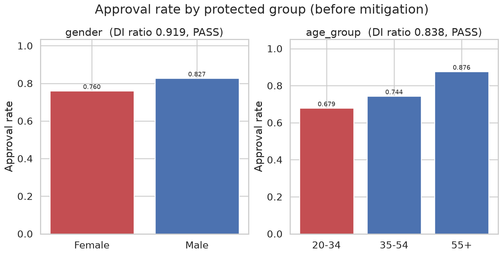
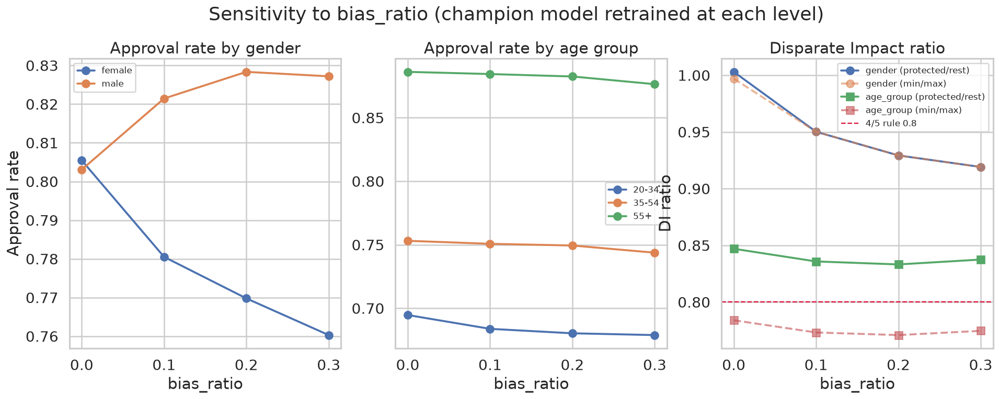
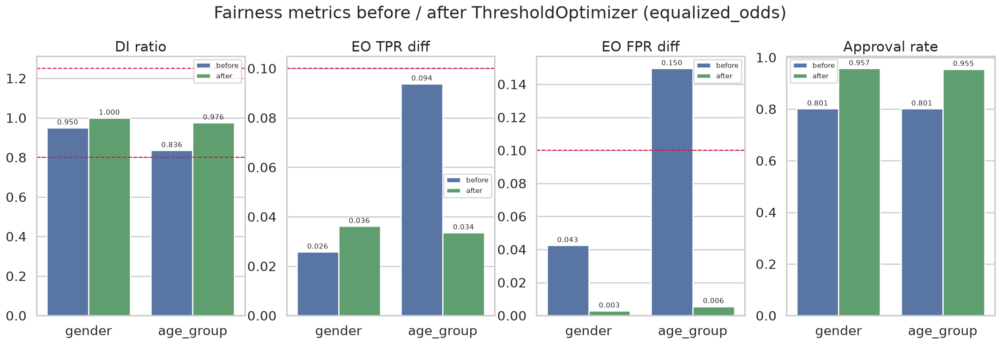
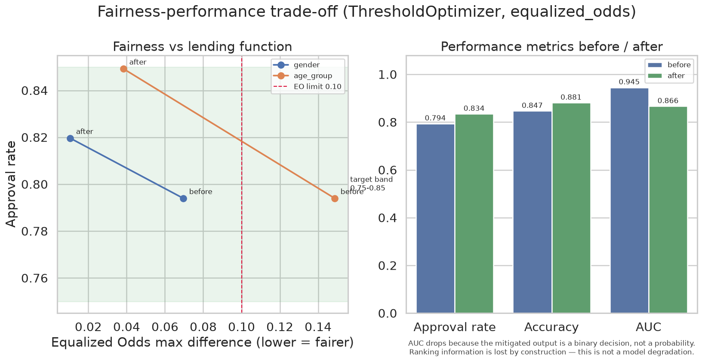

# 7. 공정성 검증과 Bias Mitigation

이 장은 "보호 속성을 모델에 보여주지 않으면 차별이 사라지는가"라는 질문에 답한다.
결론부터 말하면 **사라지지 않는다.** 그리고 편향이 전파되는 경로가 두 종류로 나뉘며,
그중 하나는 원인을 제거하는 것 자체가 예측력 손실을 수반한다.

관련 설계 결정: [ADR-002 v3](../decisions/ADR-002-bias-injection.md),
[ADR-004 v2](../decisions/ADR-004-mitigation.md),
[ADR-008](../decisions/ADR-008-protected-attributes.md)

> **이 장의 모든 측정 조건.** 챔피언 모델 `xgboost | combined | class_weight`,
> test 세트 22,500행, 승인 임계값 `p_default < 0.30`, `bias_ratio = 0.3`.
> 7.3절의 민감도 표는 각 `bias_ratio` 수준마다 데이터를 재생성하고 챔피언 조합을
> 다시 학습해 측정했으며, 조건을 표 각주에 다시 적었다.

---

## 7.1 실험 설계: 직접 경로를 차단한다

모델이 성별·연령을 입력으로 받으면 그것을 근거로 차별할 수 있다. 그건 자명하다.
이 프로젝트가 묻는 것은 그 다음이다. **보호 속성을 아예 보여주지 않아도 집단 간 격차가
생기는가.** 생긴다면 그 격차는 다른 피처를 경유해 전파된 것이므로
**간접 편향(proxy discrimination)** 이다.

이를 확인하려고 세 겹으로 설계했다.

### ① 편향은 피처에만, 타겟에는 넣지 않는다 (ADR-002)

`female` 집단과 `20-34` 집단의 `telecom_payment_rate`, `utility_payment_rate` 관측치를
`bias_ratio × 0.3` 만큼 낮춘다(`bias_ratio = 0.3` 이면 집단당 0.09 하향, 두 집단에 모두
속하면 가산). **실제 부도 라벨은 건드리지 않는다.**

즉 이것은 **측정 편향(measurement bias)** 이다. 실제 위험은 같은데 관측만 나쁘게 찍힌다.
타겟을 왜곡했다면 관측된 격차가 "실제 위험 차이"인지 "편향"인지 구분할 수 없어
Mitigation 의 의미가 사라진다.

편향 대상을 `20-34` 로 정한 것은 ADR-002 v2 의 개정 사항이다. 처음에는 `55+` 를
대상으로 했는데, 대안 피처가 연령을 신호원으로 쓰기 때문에(4장) `55+` 는 편향을
주입하지 않아도 이미 유리했다. 여기에 하향을 걸면 주입 편향이 자연 격차를 **상쇄**해
"편향을 키웠는데 격차가 줄어드는" 해석 불가능한 상황이 됐다.

### ② 보호 속성을 학습 피처에서 제외한다 (ADR-008)

`gender` 와 `age_group` 은 데이터프레임에 남지만 모델 입력 `X` 에는 들어가지 않는다.
모델이 쓰는 것은 전통 피처 13개(결측 플래그 3개 포함) + 대안 피처 5개, 총 18개다.

보호 속성을 데이터에 남겨둔 이유는 두 가지다. 공정성 지표(DI Ratio, Equalized Odds)
계산에 필요하고, Fairlearn `ThresholdOptimizer` 의 `sensitive_features` 인자로 넘겨야 한다.

`credit_history_months`, `is_thin_filer`, `thin_filer_type` 도 같이 제외했다(4.6절).

### ③ 완화는 후처리로 한다 (ADR-004)

`ThresholdOptimizer` 는 학습된 모델을 그대로 두고 집단별 임계값만 바꾼다. 덕분에
**같은 모델·같은 예측 확률 위에서** 전/후를 비교할 수 있다. 재학습이 필요한 Reweighting
계열을 쓰면 전/후에서 모델 자체가 달라져 비교가 흐려진다.

`ThresholdOptimizer` 는 valid 세트로 적합하고 test 세트로 평가했다. 테스트 라벨을
임계값 조정에 쓰면 명세 §7 의 "테스트 데이터 라벨을 학습에 사용 금지" 조항을 위반한다.

---

## 7.2 완화 전 측정

### 집단별 승인율

전체 승인율은 **0.7940** 이다.

| 보호 속성 | 집단 | n | 승인율 |
|---|---|---:|---:|
| gender | male | 11,319 | 0.8272 |
| | **female** (불이익) | 11,181 | **0.7603** |
| age_group | 55+ | 9,905 | 0.8764 |
| | 35-54 | 9,742 | 0.7438 |
| | **20-34** (불이익) | 2,853 | **0.6789** |

각주: 챔피언 `xgboost｜combined｜class_weight`, test 22,500행, 임계값 0.30, `bias_ratio=0.3`.



**20-34 집단의 승인율이 55+ 보다 19.7%p 낮다.** 모델은 연령대를 입력으로 받은 적이 없다.

### DI Ratio — 정의에 따라 판정이 갈린다

명세 §1 의 용어 정의는 "보호 집단의 승인율을 비보호 집단의 승인율으로 나눈 비율"이다.
그런데 규제 실무에서 흔히 쓰는 4/5 규칙은 **최저 승인율 집단 / 최고 승인율 집단**으로
계산한다. 3집단인 `age_group` 에서 두 정의가 다른 값을 준다.

| 보호 속성 | DI (명세 정의: 보호 / 나머지 합산) | DI (관행: 최저 / 최고) | 기준 0.8~1.25 |
|---|---:|---:|---|
| gender | 0.9191 | 0.9191 | 둘 다 충족 |
| age_group | 0.8375 | **0.7747** | **명세 정의는 충족, 관행 정의는 미달** |

같은 데이터에서 결론이 뒤집히므로 **두 값을 모두 보고한다.** API(`GET /fairness`)도
`di_ratio` 와 `di_ratio_min_max` 를 함께 반환한다.

### Equalized Odds

`y=1` 은 부도, 예측 양성은 "부도로 예측(=거절)"이다.

| 보호 속성 | 집단 | TPR | FPR |
|---|---|---:|---:|
| gender | female | 0.9113 | 0.1918 |
| | male | 0.8763 | 0.1222 |
| age_group | 20-34 | 0.9097 | 0.2464 |
| | 35-54 | 0.9148 | 0.1946 |
| | 55+ | 0.8286 | 0.0978 |

| 보호 속성 | TPR 차이 | FPR 차이 | 기준 ≤ 0.10 |
|---|---:|---:|---|
| gender | 0.0350 | 0.0696 | 충족 |
| age_group | 0.0862 | **0.1487** | **FPR 위반** |

`age_group` 의 FPR 차이 0.1487 이 의미하는 것은 이렇다. **실제로 부도가 아닌 고객을
잘못 거절하는 비율**이 20-34 에서 24.6%, 55+ 에서 9.8% 다. 정상 고객이 부당하게
거절될 확률이 젊은 집단에서 2.5배 높다.

---

## 7.3 `bias_ratio` 민감도: 두 종류의 간접 편향

`bias_ratio` 를 0.0 / 0.1 / 0.2 / 0.3 으로 바꿔가며 각 수준에서 데이터를 재생성하고
챔피언 조합(`xgboost | combined | class_weight`)을 다시 학습해 측정했다.

| `bias_ratio` | 하향폭 | female | male | **gender DI** | 20-34 | 35-54 | 55+ | age DI (명세) | **age DI (min/max)** | 전체 승인율 | test AUC |
|---:|---:|---:|---:|---:|---:|---:|---:|---:|---:|---:|---:|
| 0.0 | 0.000 | 0.8055 | 0.8031 | **1.0030** | 0.6947 | 0.7531 | 0.8861 | 0.8470 | **0.7840** | 0.8043 | 0.9497 |
| 0.1 | 0.030 | 0.7805 | 0.8215 | 0.9502 | 0.6838 | 0.7508 | 0.8844 | 0.8358 | 0.7732 | 0.8011 | 0.9485 |
| 0.2 | 0.060 | 0.7698 | 0.8283 | 0.9293 | 0.6803 | 0.7494 | 0.8825 | 0.8332 | 0.7709 | 0.7992 | 0.9465 |
| 0.3 | 0.090 | 0.7603 | 0.8272 | **0.9191** | 0.6789 | 0.7438 | 0.8764 | 0.8375 | 0.7747 | 0.7940 | 0.9453 |

각주: 각 행마다 시뮬레이션 → 전처리 → 챔피언 조합 재학습 → test 평가. 임계값 0.30.
`src/fairness/sensitivity.py` 로 재현 가능. 원본은
`data/processed/fairness/bias_ratio_sensitivity.csv`.



### 성별 = 주입한 측정 편향

`bias_ratio = 0` 에서 **gender DI 가 1.0030** 이다. 편향을 주입하지 않으면 성별 간
승인율이 사실상 같다(female 0.8055 vs male 0.8031). 그리고 `bias_ratio` 를 올릴수록
DI 가 1.0030 → 0.9502 → 0.9293 → 0.9191 로 **단조 감소**한다.

따라서 성별 격차는 **전적으로 주입한 측정 편향이 대안 피처를 경유해 전파된 결과**다.
명세 §4 가 요구한 "`bias_ratio` 를 조정하면 성별/연령대별 승인율 편향이 변경된다"는
이 표로 실증된다.

성별은 GMSC 에 없어 **무작위 50:50 으로 합성**했다(ADR-002). 타겟과 독립이므로
편향을 주입하지 않으면 격차가 없는 것이 당연하다. 이 통제된 성질 덕분에
"주입한 만큼만 나타난다"를 깨끗하게 보일 수 있었다.

### 연령대 = 피처에 내재한 상관

같은 표의 연령대 열은 전혀 다른 이야기를 한다. **`bias_ratio = 0` 에서 이미 min/max DI 가
0.7840** 으로 4/5 규칙에 미달한다. 그리고 0.3 까지 올려도 0.7747 로 **거의 변하지 않는다
(−0.009).**

원인은 4장의 시뮬레이터 구조에 있다. 대안 피처는 소득·연령을 신호원으로 생성된다.

```
nuisance = 0.7 · z(log1p(MonthlyIncome)) + 0.3 · z(age)
```

연령이 높을수록 `nuisance` 가 커지고 대안 피처 값이 좋게 나온다. 학습 데이터에서
`telecom_payment_rate` 의 연령대별 평균(표준화 값)은 20-34 −0.978 / 35-54 +0.024 /
55+ +0.263 이다. 모델이 연령대를 보지 않아도 **대안 피처를 통해 연령 정보를 간접적으로
학습**한다.

### 두 경로의 대비 — 이 실험의 핵심 결과

| | 성별 | 연령대 |
|---|---|---|
| 편향의 출처 | 의도적으로 주입한 측정 편향 | 피처 생성 구조에 내재한 상관 |
| `bias_ratio = 0` 에서 | DI 1.0030 (완전 균등) | min/max DI 0.7840 (**이미 미달**) |
| `bias_ratio` 반응 | 단조 감소 (−0.084) | 거의 불변 (−0.009) |
| 원인 제거 | `bias_ratio = 0` 으로 두면 사라진다 | 연령 신호를 빼야 하는데 **예측력이 줄어든다** |

**실무적으로 후자가 훨씬 까다롭다.** 편향을 주입한 적이 없어도, 대안 데이터가 보호
속성과 자연스럽게 상관되어 있으면 그 상관이 그대로 결정에 실린다. 그리고 원인을
제거하려면 피처에서 그 정보를 빼야 하는데, 그것은 예측력의 일부를 버리는 일이다.
4.5절의 `w` 레버 실험에서 확인한 것과 같은 구조다. 공유요인을 키워도 전통 피처와의
상보성은 줄지 않았고, 상관 자체를 낮추자 성능이 함께 내려갔다.

> 이것이 실제 대안신용평가에서 반복될 문제다. 통신 요금 납부 이력은 연령과 상관되어 있고,
> 앱 사용 빈도도 그렇다. 보호 속성을 입력에서 제외하는 것은 **필요하지만 충분하지 않다.**

---

## 7.4 Bias Mitigation 결과

`ThresholdOptimizer(constraints="equalized_odds", objective="balanced_accuracy_score")` 를
보호 속성별로 각각 적합했다.

| 지표 | gender 전 → 후 | age_group 전 → 후 |
|---|---|---|
| DI Ratio (명세 정의) | 0.9191 → **0.9942** | 0.8375 → **0.9433** |
| DI Ratio (min/max) | 0.9191 → 0.9942 | **0.7747 → 0.9245** |
| EO TPR 차이 | 0.0350 → 0.0106 | 0.0862 → 0.0384 |
| EO FPR 차이 | 0.0696 → 0.0064 | **0.1487 → 0.0155** |
| 전체 승인율 | 0.7940 → 0.8196 | 0.7940 → 0.8492 |
| 정확도 | 0.8466 → 0.8701 | 0.8466 → 0.8921 |
| AUC | 0.9453 → 0.8736 | 0.9453 → 0.8592 |

각주: valid 22,500행으로 적합, test 22,500행으로 평가. `random_state=42`.

기준을 위반했던 `age_group` 의 EO FPR 차이가 **0.1487 → 0.0155** 로 해소되고,
min/max DI 도 0.7747 → 0.9245 로 4/5 규칙을 넘겼다. 승인율은 0.79 → 0.82~0.85 로
소폭 올라가는 데 그쳐 심사 기능이 유지된다.



### 집단별 조정 임계값

`ThresholdOptimizer` 는 집단마다 두 개의 임계값 규칙을 확률적으로 섞는다(보간).

| 보호 속성 | 집단 | 규칙 | 완화 후 승인율 |
|---|---|---|---:|
| gender | female | 64.1% `p>0.4492` / 35.9% `p>0.4285` | 0.8172 |
| | male | 1.5% `p>0.4087` / 98.5% `p>0.2878` | 0.8220 |
| age_group | 20-34 | 38.1% `p>0.7164` / 61.9% `p>0.5644` | 0.8069 |
| | 35-54 | 8.0% `p>0.7107` / 92.0% `p>0.5453` | 0.8376 |
| | 55+ | 51.2% `p>0.4159` / 48.8% **`p>0.1956`** | 0.8728 |

읽는 방식은 이렇다. 원래는 모든 집단에 `p < 0.30` 이면 승인이라는 단일 임계값을 썼다.
완화 후 20-34 는 `p` 가 0.56~0.72 미만이면 승인되고, 55+ 는 0.20~0.42 미만이어야 승인된다.
**젊은 집단은 완화되고 고령 집단은 엄격해진다** — 편향 보정 방향이 의도와 맞다.

### AUC 하락은 성능 저하가 아니다

완화 후 AUC 가 0.9453 → 0.86 대로 떨어진다. **이것은 모델이 나빠진 것이 아니다.**

완화 전 출력은 0~1 사이의 **부도 확률**이고, AUC 는 그 확률의 **순위 품질**을 재는
지표다. 완화 후 출력은 승인/거절이라는 **이진 결정**이다. 확률 순위 정보가 사라졌으므로
이진 벡터로 계산한 AUC 는 원리적으로 낮아진다. 실제로 이진 예측의 AUC 는
`(TPR + TNR) / 2` 와 같다. 즉 balanced accuracy 를 보고 있는 셈이다.

모델의 가중치도, 확률 출력도 바뀌지 않았다. 바뀐 것은 집단별 임계값뿐이다.
같은 표에서 **정확도는 0.8466 → 0.8921 로 올랐다**는 점도 함께 보아야 한다.

> **따라서 완화 전/후 비교는 AUC 가 아니라 DI Ratio, Equalized Odds, 승인율로 판단한다.**
> AUC 는 완화 전 모델의 판별력을 보고할 때만 쓴다. API 응답
> (`GET /fairness/mitigation`)도 이 주의사항을 `note` 필드로 함께 반환한다.

### 목적함수를 바꾼 이유 (ADR-004 v2)

처음에는 `objective="accuracy_score"` 로 적합했다. 그 결과는 이렇다.

| 지표 | 완화 전 | `accuracy` | `balanced_accuracy` (채택) |
|---|---:|---:|---:|
| 전체 승인율 | 0.7940 | **0.9546 ~ 0.9572** | 0.8196 ~ 0.8492 |
| AUC | 0.9453 | 0.7389 ~ 0.7411 | 0.8592 ~ 0.8736 |
| DI Ratio (gender / age_group) | 0.9191 / 0.8375 | 1.0000 / 0.9759 | 0.9942 / 0.9433 |

각주: `accuracy` 열은 `bias_ratio=0.1` 데이터에서 측정한 값이다(ADR-004 v2 개정 시점).
`balanced_accuracy` 열은 최종 데이터(`bias_ratio=0.3`) 기준이다.

`accuracy` 목적함수에서 공정성 지표는 더 좋아 보였다(DI 1.0000). 그러나 **승인율이
0.79 에서 0.95 로 뛰었다.** 부도율이 6.7% 인 데이터에서 정확도를 최대화하면
"거의 전부 승인"이 최적해가 되기 때문이다.

이것은 공정성 개선이 아니라 **심사 기능의 상실**이다. 공정성 지표가 좋아진 이유도
"모두를 승인하면 집단 간 승인율 격차가 사라진다"는 자명한 사실일 뿐이다.
`balanced_accuracy_score` 는 TPR 과 TNR 의 평균이라 소수 클래스를 무시할 수 없다.
전부 승인하면 TPR 이 0 이 되어 목적함수가 0.5 로 떨어진다.

---

## 7.5 공정성-성능 트레이드오프



왼쪽은 공정성(Equalized Odds 최대 차이)과 심사 기능(승인율)의 관계다. 두 보호 속성 모두
완화 후 EO 차이가 기준선(0.10) 왼쪽으로 이동하고, 승인율은 목표 구간(0.75~0.85, 음영)
안에 머문다. `age_group` 의 이동 폭이 큰 것은 완화 전 위반 정도가 컸기 때문이다.

오른쪽은 승인율·정확도·AUC 의 전후 비교다. AUC 만 내려가고 정확도는 올라간다는 점이
앞 절에서 설명한 "순위 정보 소실"의 직접적인 증거다.

### 규제 관점

금융위원회 금융분야 AI 가이드라인과 신용정보법 제36조의2 는 자동화평가에 대해
설명가능성과 공정성을 요구한다. 본 시스템이 대응하는 방식은 다음과 같다.

| 요건 | 대응 |
|---|---|
| 자동화평가 결과 설명 | `POST /explain` 이 거절 사유 Top 5 를 자연어로 반환 (6장) |
| 공정성 지표 모니터링 | `GET /fairness` 가 DI 양 정의와 EO 를 반환, 기준 이탈 시 WARNING 로그 |
| 편향 완화 조치 기록 | `GET /fairness/mitigation` 이 전/후와 집단별 조정 임계값을 반환 |
| 민감정보 사용 금지 | 보호 속성을 학습 피처에서 제외 (ADR-008) |

다만 `ThresholdOptimizer` 가 예측을 확률적으로 섞는다는 점은 실서비스에서 문제가 될 수
있다. 같은 고객에게 항상 같은 결정이 나오지 않기 때문이다. 10장에서 한계로 다룬다.

---

## 이 장의 결론

1. **보호 속성을 학습에서 제외해도 편향은 전파된다.** 모델이 연령대를 본 적 없는데도
   20-34 집단의 승인율이 55+ 보다 19.7%p 낮고, min/max DI 0.7747 로 4/5 규칙에 미달하며
   EO FPR 차이 0.1487 로 기준을 위반한다.
2. **전파 경로는 두 종류다.** 성별은 주입한 측정 편향(`bias_ratio=0` 에서 DI 1.0030 →
   단조 감소), 연령대는 피처에 내재한 상관(`bias_ratio=0` 에서 이미 0.7840, 이후 불변).
   후자는 원인 제거가 예측력 손실을 수반하므로 **사후 임계값 조정이 현실적 대응**이다.
3. **완화는 작동하지만 목적함수 선택이 결정적이다.** `balanced_accuracy` 로 EO FPR 차이를
   0.1487 → 0.0155 로 낮추면서 승인율을 0.85 이내로 유지했다. `accuracy` 를 썼을 때는
   승인율이 0.95 로 뛰어 심사 기능 자체를 잃었다.
