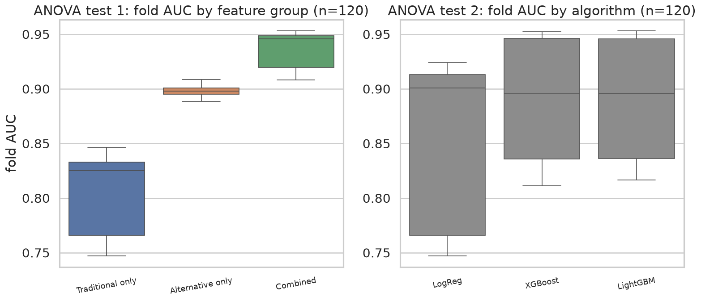

# 8. ANOVA 통계 검증

앞의 5~7장은 test 세트에서 얻은 단일 수치를 비교했다. 이 장은 그 차이가 **우연으로
설명되지 않는지**를 통계적으로 검정한다. 그리고 검정 결과를 어떻게 읽어야 하는지,
특히 효과크기 η² 가 0.95 를 넘는 값을 어떻게 해석해야 하는지를 다룬다.

관련 설계 결정: [ADR-005](../decisions/ADR-005-anova-unit.md),
[ADR-011](../decisions/ADR-011-anova-control.md),
[ADR-012](../decisions/ADR-012-champion-algorithm.md)

명세(SPEC §5)가 요구하는 두 검정은 다음과 같다.

| 검정 | 유형 | 비교 대상 | 목적 |
|---|---|---|---|
| 검증 1 | One-way ANOVA | 피처 그룹 (전통 / 대안 / 통합) | 대안 데이터 효용성 검증 |
| 검증 2 | One-way ANOVA | 알고리즘 (LR / XGBoost / LightGBM) | 최적 알고리즘 선정 근거 |

---

## 8.1 관측 단위와 통제 방식

### 관측 단위: 반복 교차검증 (ADR-005)

ANOVA 의 관측치는 **fold 별 AUC** 다. 단일 5-Fold CV 를 쓰면 그룹당 n = 5 다.
이 표본 크기로는 검정력이 낮아 실제 차이를 잡아내지 못하고, 정규성·등분산 가정을
확인할 근거조차 부족하다.

그래서 `RepeatedStratifiedKFold(n_splits=5, n_repeats=4)` 를 써서 **그룹당 n = 20** 을
확보했다. 18개 조합 × 20 fold = 총 **360건**이 `data/processed/fold_auc.csv` 에 있다.

### 통제: 나머지 요인을 고정한다 (ADR-011)

360건을 피처 그룹으로 나누면 그룹당 120건이다. 그러나 이 120건은 **피처 그룹의 반복
관측이 아니다.** 알고리즘 3종과 불균형 처리 2종이 안에 섞여 있기 때문이다.

그대로 One-way ANOVA 에 넣으면 피처 그룹 효과와 알고리즘 효과가 **교락(confounded)** 된다.
집단 내 분산이 "같은 조건의 fold 간 변동"이 아니라 "알고리즘이 다른 데서 오는 변동"까지
포함하게 되어 F 통계량의 의미가 흐려진다.

그래서 각 검정에서 나머지 요인을 한 수준으로 고정했다. 고정 값은 최종 채택 조합
(`config.models.champion`)을 따른다. 그러면 검정 결과가 실제로 배포되는 모델 구성에
대한 진술이 된다.

| 검정 | 비교 요인 | 고정 요인 | 그룹당 n |
|---|---|---|---:|
| 검증 1 | 피처 그룹 | 알고리즘 = `xgboost`, 불균형 = `class_weight` | **20** |
| 검증 2 | 알고리즘 | 피처 그룹 = `combined`, 불균형 = `class_weight` | **20** |

### 통제 vs pooled — 통제가 왜 필요한지의 직접 증거

같은 데이터로 통제한 결과와 통제하지 않은(pooled) 결과를 나란히 산출했다.

| 검정 | 통제 (n=20) F | 통제 η² | pooled (n=120) F | **pooled η²** |
|---|---:|---:|---:|---:|
| 검증 1 (피처 그룹) | 4245.65 | 0.9933 | 1031.64 | 0.8525 |
| 검증 2 (알고리즘) | 804.38 | 0.9658 | 16.08 | **0.0826** |

각주: 동일한 `fold_auc.csv` 360건. 통제는 champion 조합 고정, pooled 는 전체 사용.
`src/statistics/anova.py` 가 두 결과를 함께 산출한다.

**검증 2 의 η² 가 0.9658 에서 0.0826 으로 급락한다.** pooled 에서는 피처 그룹 효과
(traditional 0.836 ~ combined 0.945, 0.11 폭)가 집단 내 분산으로 흘러들어가
알고리즘 효과(0.912 ~ 0.945, 0.033 폭)를 압도한다. 검증 1 에서는 알고리즘 간 차이가
피처 그룹 간 차이보다 작아 감소 폭이 덜하다(0.9933 → 0.8525).

pooled 결과도 리포트에 병기하되 **참고치**로만 쓴다. API(`GET /anova`)는 통제된 결과를
반환한다.

---

## 8.2 검증 1: 피처 그룹별 AUC 비교

### 결과

| 집단 | n | 평균 AUC | 표준편차 |
|---|---:|---:|---:|
| `traditional_only` | 20 | 0.8355 | 0.0047 |
| `alternative_only` | 20 | 0.8917 | 0.0039 |
| `combined` | 20 | **0.9451** | 0.0024 |

각주: `xgboost` · `class_weight` 고정, RepeatedStratifiedKFold(5×4), train 104,999행 내부 CV.

**F = 4245.65, p = 9.64 × 10⁻⁶³, η² = 0.9933 [Large (strong)]**

p < 0.05 이므로 사후검정을 수행했다.

| 비교 | 평균 차이 | p_adj | 유의 |
|---|---:|---:|---|
| `combined` vs `traditional_only` | **+0.1096** | < 0.0001 | 예 |
| `alternative_only` vs `traditional_only` | +0.0562 | < 0.0001 | 예 |
| `combined` vs `alternative_only` | +0.0534 | < 0.0001 | 예 |

### 해석

세 쌍 모두 유의하다. 그리고 차이의 방향과 크기가 두 가지를 말해준다.

**첫째, 대안 데이터는 단독으로도 전통 데이터를 앞선다** (+0.0562). 통신비·공과금 납부
이력만으로 만든 모델이 전통 신용 피처 13개를 쓴 모델보다 낫다. 이는 4.3절에서 설명한
시뮬레이터의 구조적 성질(명세의 상관 요건이 관대하다) 때문이며, 실제 대안 데이터가
그렇다는 뜻은 아니다.

**둘째, 통합 시 추가 이득이 있다** (+0.0534). 대안 데이터만으로 0.892 에 도달한 뒤에도
전통 피처를 더하면 0.945 로 올라간다. 두 정보원이 서로 다른 것을 담고 있다는 뜻이며,
4.5절에서 "누수가 아니라 상보성"이라고 판정한 근거와 같다.

---

## 8.3 검증 2: 알고리즘별 AUC 비교

### 결과

| 집단 | n | 평균 AUC | 표준편차 |
|---|---:|---:|---:|
| `logistic_regression` | 20 | 0.9120 | 0.0037 |
| `lightgbm` | 20 | 0.9443 | 0.0027 |
| `xgboost` | 20 | **0.9451** | 0.0024 |

각주: `combined` · `class_weight` 고정, RepeatedStratifiedKFold(5×4).

**F = 804.38, p = 1.68 × 10⁻⁴², η² = 0.9658 [Large (strong)]**

| 비교 | 평균 차이 | p_adj | 유의 |
|---|---:|---:|---|
| `xgboost` vs `logistic_regression` | +0.0331 | < 0.0001 | 예 |
| `lightgbm` vs `logistic_regression` | +0.0323 | < 0.0001 | 예 |
| **`xgboost` vs `lightgbm`** | **+0.0008** | **0.6468** | **아니오** |

### 해석: 주장할 수 있는 범위

F 검정은 유의하지만 사후검정을 보면 **부스팅 계열 두 개가 서로 구분되지 않는다.**
평균 차이 0.0008 은 집단 내 표준편차(0.0024~0.0027)보다도 작다.

따라서 이 검정으로 주장할 수 있는 것은 여기까지다.

> **부스팅 계열(XGBoost, LightGBM)이 Logistic Regression 보다 통계적으로 유의하게 우수하다.**

"XGBoost 가 가장 성능이 좋다"는 서술은 데이터가 뒷받침하지 않는다. 이 결과에 따라
챔피언 알고리즘의 선정 근거를 변경했다([ADR-012](../decisions/ADR-012-champion-algorithm.md)).
XGBoost 를 채택한 이유는 성능이 아니라 **SHAP TreeExplainer 지원 성숙도와 참조 자료의
풍부함**이다. 설명가능성이 이 프로젝트의 핵심 산출물이므로 해석 도구와의 궁합을 우선했다.

성능이 동등하므로 학습·추론 비용이 병목이 되면 LightGBM 으로 교체해도 논거가 훼손되지 않는다.

---

## 8.4 가정 진단

One-way ANOVA 는 정규성과 등분산성을 가정한다. 두 검정 모두 진단했다.

### Shapiro-Wilk (정규성)

| 검정 | 집단 | W | p | 판정 |
|---|---|---:|---:|---|
| 검증 1 | `traditional_only` | 0.9847 | 0.9797 | 충족 |
| | `alternative_only` | 0.9808 | 0.9436 | 충족 |
| | `combined` | 0.9555 | 0.4587 | 충족 |
| 검증 2 | `logistic_regression` | 0.9253 | 0.1251 | 충족 |
| | `lightgbm` | 0.9678 | 0.7082 | 충족 |
| | `xgboost` | 0.9555 | 0.4587 | 충족 |

### Levene (등분산성, 중앙값 기준)

| 검정 | 통계량 | p | 판정 |
|---|---:|---:|---|
| 검증 1 | 2.7107 | 0.0751 | 충족 |
| 검증 2 | 2.3292 | 0.1066 | 충족 |

6개 집단 전부 정규성을 충족하고 두 검정 모두 등분산을 충족한다. 따라서 표준
One-way ANOVA 결과를 그대로 사용한다.

다만 **Levene p 값이 0.075 / 0.107 로 기준(0.05)에 가깝다.** 집단 내 표준편차가
0.0024 ~ 0.0047 로 최대 두 배 차이가 나기 때문이다(`combined` 가 가장 작고
`traditional_only` 가 가장 크다). 설정이 조금 바뀌면 등분산 가정이 기각될 수 있다.

이를 대비해 `src/statistics/anova.py` 는 가정 위반을 자동 감지하고 대안 검정을 함께
산출한다. 등분산 위반 시 **Welch ANOVA**(Alexander-Govern), 정규성 위반 시
**Kruskal-Wallis** 를 결과 JSON 에 추가한다. 현재 데이터에서는 두 가정 모두 충족되어
호출되지 않았다.

왼쪽이 검증 1, 오른쪽이 검증 2 다. 검증 1 의 세 집단은 상자가 서로 겹치지 않는다.
검증 2 에서는 `lightgbm` 과 `xgboost` 의 상자가 거의 완전히 겹쳐, Tukey 결과
(p_adj = 0.6468)를 시각적으로 확인할 수 있다.

---

## 8.5 η² > 0.95 를 어떻게 읽어야 하는가

두 검정의 η² 는 0.9933 과 0.9658 이다. 명세의 해석 기준(0.14 이상이면 Large)에
비추면 극단적으로 큰 값이다. **이 값을 "대안 데이터가 성능의 99% 를 설명한다"로 읽으면
안 된다.**

### 왜 이렇게 큰가

η² 는 `집단간 제곱합 / 전체 제곱합` 이다. 분모의 대부분을 집단간 분산이 차지하려면
**집단 내 분산이 작아야** 한다. 본 실험에서 집단 내 표준편차는 0.0024 ~ 0.0047 이다.

작은 이유는 실험 설계 때문이다.

- **집단이 서로 다른 피처 구성/알고리즘으로 고정돼 있다.** 각 집단 안에서 변하는 것은
  fold 뿐이다.
- **동일한 데이터에 반복 CV 를 적용했다.** 20개 fold 는 같은 104,999행을 다르게 쪼갠
  것이므로 서로 강하게 닮아 있다. 관측치가 독립 표본이 아니다.

즉 η² 가 큰 것은 효과가 실무적으로 크다는 뜻이 아니라, **분모가 작게 나오는 설계**의
결과다. 실험 설계상 필연적인 과대평가다.

### p-value 도 보수적으로 읽어야 한다

같은 이유로 p-value 는 실제보다 작게 나온다. ANOVA 는 관측치의 독립성을 가정하는데
반복 CV fold 는 완전히 독립이 아니다. p = 9.64 × 10⁻⁶³ 같은 값을 문자 그대로
"우연일 확률이 10⁻⁶³" 로 읽어서는 안 된다.

### 실무 판단은 평균 차이의 절대 크기로

그래서 판단 기준을 Tukey HSD 의 `mean_diff` 로 옮긴다.

| 비교 | mean_diff | 실무적 판단 |
|---|---:|---|
| `combined` vs `traditional_only` | **+0.1096** | AUC 0.11 차이 — 의미 있는 개선 |
| `alternative_only` vs `traditional_only` | +0.0562 | 의미 있는 개선 |
| `combined` vs `alternative_only` | +0.0534 | 의미 있는 개선 |
| `xgboost` vs `lightgbm` | **+0.0008** | **무의미** (표준편차보다 작다) |

같은 검정 안에서 η² 는 둘 다 0.95 를 넘지만, mean_diff 는 0.11 과 0.0008 로
**130배 차이**가 난다. η² 만 보면 두 검정이 비슷하게 강력해 보이지만 실제 함의는 전혀 다르다.

`src/statistics/anova.py` 는 η² 가 설정된 임계값(`anova.eta_squared_extreme = 0.90`)을
넘으면 결과 JSON 에 `effect_size_note` 필드로 이 주의사항을 자동 첨부한다.
API 응답과 대시보드 통계 검증 탭에도 경고로 표시된다.

---

## 이 장의 결론

1. **두 검정 모두 유의하다.** 검증 1(피처 그룹) F=4245.65, p<0.001, η²=0.9933 /
   검증 2(알고리즘) F=804.38, p<0.001, η²=0.9658. 정규성·등분산 가정도 6개 집단
   전부 충족한다.
2. **통제가 결과를 바꾼다.** 나머지 요인을 고정하지 않으면 검증 2 의 η² 가
   0.9658 → 0.0826 으로 급락한다. 피처 그룹 효과가 알고리즘 효과를 압도하기 때문이며,
   ADR-011 의 통제 방식이 필요한 이유의 직접 증거다.
3. **η² 와 p-value 는 과대평가된 값이다.** 집단 내 분산이 작고(SD 0.0024~0.0047)
   반복 CV fold 가 독립이 아니기 때문이다. 실무 판단은 Tukey `mean_diff` 로 한다 —
   `combined` vs `traditional` +0.1096 은 의미 있고, `xgboost` vs `lightgbm` +0.0008 은
   무의미하다.
